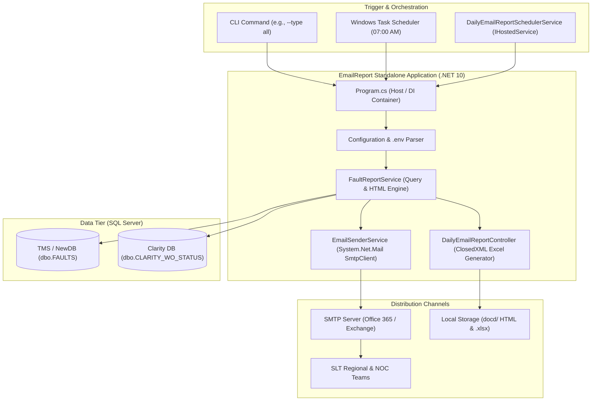

# Report 01: System Architecture & Decoupling Deep Study
## SLT NOC Automated Email Reporting Standalone Application

---

## 1. System Overview & Problem Context

In telecommunications network operations at SLT, early-morning operational handover relies upon timely reports summarizing all pending customer complaints, data circuit interruptions, and network equipment outages as of **07:00 AM**.

Previously, the email dispatch engine and scheduler lived inside the **`AlarmSystem`** web application (`Microsoft.NET.Sdk.Web`). While convenient during initial prototyping, this created several operational and architectural challenges:
* **IIS / Kestrel Lifecycle Issues**: Web application idle timeouts and worker recycling could interrupt scheduled dispatches.
* **Database Connection Contention**: Heavy analytical report queries executing during morning shift handover competed with live web dashboard users for SQL connections.
* **Maintenance & Deployment Risk**: Updating an email template or changing a recipient list required restarting the entire NOC monitoring web portal.

### The Decoupling Solution
The email reporting subsystem was extracted into an autonomous **.NET 10 Console Application** (`Microsoft.NET.Sdk`), designed with a dual-execution model:
1. **CLI / Task Scheduler Mode**: Triggered on-demand or by OS-level schedulers to execute a batch run and exit immediately.
2. **Hosted Daemon Mode**: Runs as a continuous background daemon (`IHostedService`) monitoring the system clock for scheduled windows.

---

## 2. Architecture & Data Flow



---

## 3. Decoupling Analysis: Before vs. After

| Architectural Attribute | Monolithic Web App (`AlarmSystem`) | Standalone Console App (`email report`) |
| :--- | :--- | :--- |
| **Project SDK** | `Microsoft.NET.Sdk.Web` (Kestrel Web Server) | `Microsoft.NET.Sdk` (Pure Console Application) |
| **Process Model** | Persistent ASP.NET Core Web Host | Ephemeral batch process or standalone daemon |
| **Memory Footprint** | ~150 MB – 300 MB (Web pipeline + MVC + Auth) | ~25 MB – 45 MB (Focused CLI execution) |
| **Scheduler Reliability** | Dependent on web server staying active 24/7 | Decoupled; executed via Windows Task Scheduler |
| **Deployment Independence** | Any template fix required redeploying web app | Can be updated, tested, and published independently |
| **Database Contention** | Shared `SqlConnection` pool with web portal | Independent scoped connections with aggressive cleanup |

---

## 4. Dependency Injection & Service Registration

The standalone application registers minimal, purpose-built dependencies inside [`Program.cs`](file:///D:/SLT_Projects/Project%2003/AlarmSystem_23062026/email%20report/Program.cs):

```csharp
// 1. Configuration & Logging
services.AddSingleton<IConfiguration>(configuration);
services.AddLogging(b => { b.AddConfiguration(configuration.GetSection("Logging")); b.AddConsole(); });

// 2. SQL Server Connection (Scoped per execution)
services.AddScoped<SqlConnection>(_ =>
{
    var connStr = configuration.GetConnectionString("NewDB")
               ?? configuration.GetConnectionString("TMS")
               ?? configuration.GetConnectionString("DefaultConnection");
    return new SqlConnection(connStr);
});

// 3. Options Pattern for Email Configuration
services.Configure<EmailReportingOptions>(configuration.GetSection("EmailReporting"));

// 4. Core Business Services
services.AddScoped<FaultReportService>();             // SQL extraction & HTML rendering
services.AddScoped<DailyEmailReportController>();    // ClosedXML Excel builders
services.AddSingleton<IEmailSenderService, EmailSenderService>(); // SMTP transport
services.AddHostedService<DailyEmailReportSchedulerService>();    // Background scheduler daemon
```

---

## 5. File System Organization

```
email report/
├── EmailReport.csproj          # .NET 10 Console project file
├── Program.cs                  # Entry point, CLI parser, DI builder
├── appsettings.json            # Database & SMTP configurations
├── .env.example                # Template for external environment secrets
├── README.md                   # Quick-start documentation
├── Configuration/
│   └── EmailReportingOptions.cs# Options class mapping appsettings
├── Controllers/
│   └── DailyEmailReportController.cs # ClosedXML Excel workbook builders
├── Models/
│   ├── EmailReport/            # Data Transfer Objects for Types 1–4
│   └── PendingFaultReport/     # Legacy compatibility DTO
├── Services/
│   ├── EmailReporting/         # Background scheduler hosted service
│   ├── EmailSender/            # SMTP client & report dispatcher
│   └── FaultReportService/     # SQL query definitions & HTML templates
├── docd/                       # Generated live HTML and Excel reports & docs
└── sql/
    └── EmailReport_Queries.sql # Standalone reference SQL scripts
```
