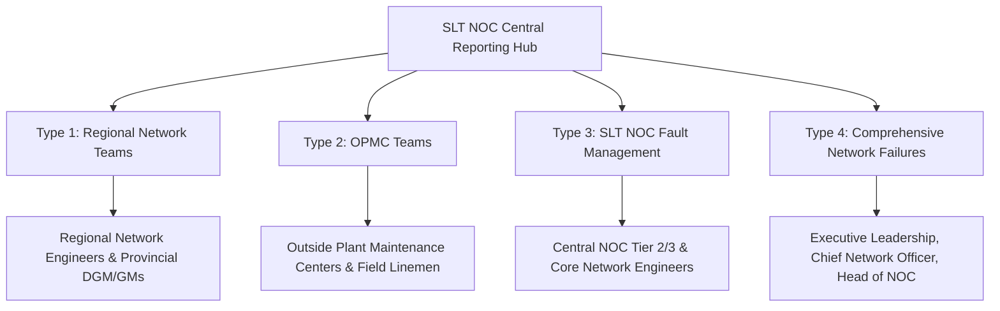

# Report 03: Report Types Deep Study & Specifications
## Detailed Functional Analysis of SLT NOC Daily Report Types

---

## 1. Overview of Report Types

The system produces 4 distinct report types every morning, each addressing a specific operational tier and technical audience within Sri Lanka Telecom.

---

## 2. Type 1: Pending Regional Network Faults

### Purpose & Audience
Summarizes customer-facing data circuits currently held up at Regional Network engineering workgroups. Regional Network Engineers use this report to prioritize field dispatch, verify SLA breach risks, and clear backlogs.

* **Email Subject**: `Pending Data Faults Related to Regional Network Teams as at 07:00 AM (DD MMM YYYY)`
* **Latest Database Snapshot**: **8 Active Faults**

### Data Fields Specification
| # | Field Name | Data Source | Sample Value | Purpose |
| :- | :--- | :--- | :--- | :--- |
| 1 | **No** | Sequence | `1`, `2`, `3` | Table index |
| 2 | **Data Circuit ID** | `f.data_circuit_id` | `IP-VPN-100234` | Unique SLT circuit identifier |
| 3 | **Details Of Customer** | `f.cust_name` | `Bank of Ceylon - Branch 04` | Impacted enterprise client |
| 4 | **Fault Date** | `w.STARTED_TIME` | `2026-10-18` | Date work order opened |
| 5 | **Fault Time** | `w.STARTED_TIME` | `14:22` | Time work order opened |
| 6 | **Work Orders Held Up At**| `w.WORKGROUP` | `WP-SOUTH_NW_ENG` | Specific regional team holding the ticket |
| 7 | **Description** | `f.description` | `Fiber Cut / Link Down` | Operational issue summary |
| 8 | **Duration Of Complaint** | Calculated | `16h 38m` | Time elapsed until 07:00 AM cutoff |
| 9 | **Region** | `w.REGION` | `WP-SOUTH` | Regional operational zone |
| 10| **Province** | `w.PROVINCE` | `Western Province` | Administrative province |

---

## 3. Type 2: Pending OPMC Faults

### Purpose & Audience
Targets Outside Plant Maintenance Centers (OPMCs). These faults represent physical copper/fiber cable damages, joint box failures, and pole damages requiring field lineman teams.

* **Email Subject**: `Pending Data fault related to OPMC as at 07:00 AM (DD MMM YYYY)`
* **Latest Database Snapshot**: **4 Active Faults**

### Data Fields Specification
| # | Field Name | Data Source | Sample Value | Purpose |
| :- | :--- | :--- | :--- | :--- |
| 1 | **No** | Sequence | `1`, `2` | Table index |
| 2 | **REPORTED DATE** | `f.reportedtime` | `2026-10-18` | Date complaint logged by customer |
| 3 | **CIRCUIT NAME** | `f.data_circuit_id` | `ETH-PRI-8832` | Circuit name / ID |
| 4 | **CUSTOMER** | `f.cust_name` | `Commercial Bank ATM 12` | Affected client |
| 5 | **OUTAGE TIME** | `f.reportedtime` | `22:15` | Outage start time |
| 6 | **LEA** | `f.lea` | `KL` (Kalutara) | Local Exchange Area code |
| 7 | **RELEVANT OPMC** | `w.WORKGROUP` | `OPMC Kalutara` | Field maintenance center responsible |
| 8 | **DGM** | `w.REGION` | `DGM WP-South` | Deputy General Manager division |
| 9 | **GM** | `w.PROVINCE` | `GM Western Province` | General Manager division |
| 10| **DESCRIPTION / RECENT UPDATE** | `f.description` + Comments | `Core joint broken, splicer on site` | Technical status and latest comments |

---

## 4. Type 3: SLT NOC Fault Management

### Purpose & Audience
Designed for central Tier 2/3 Fault Management and NOC teams who manage core routing, switching, and internal escalation.

* **Email Subject**: `Pending Data Faults Related to SLT NOC - Fault Management Teams as at 07:00 AM (DD MMM YYYY)`
* **Latest Database Snapshot**: **55 Active Faults**

### Key Features
* **Summary Matrix**: Displays an aggregated fault count broken down by Province and Workgroup at the top of the email.
* **Detailed Breakdown**: Lists all 55 active tickets with customer name, circuit ID, duration, and latest NOC engineer activity log.

---

## 5. Type 4: Comprehensive Network Failures

### Purpose & Audience
The flagship executive-level daily report. Provides a complete bird's-eye view of all physical infrastructure outages across Sri Lanka.

* **Email Subject**: `Pending Network Failures as at 07:00 AM on DD MMM YYYY`
* **Latest Database Snapshot**: **12 Outages** (2 MSAN outages, 10 4G site outages, 0 Transmission outages)

### 3-Section Modular Layout
1. **Section 1: MSAN Outages**
   * Multi-Service Access Node (MSAN) power failures, optical line termination disconnects, and DSLAM down alarms.
   * Fields: Node Name, Management IP, Region, Province, Outage Timestamp, Total Duration.
2. **Section 2: SLT 4G Site Failures**
   * Base station / eNodeB outages impacting LTE, broadband, and mobile connectivity.
   * Fields: Node Name, IP Address, Region, Province, Outage Duration.
3. **Section 3: Transmission Outages**
   * Critical DWDM, SDH, and SLBN core backbone link interruptions.
4. **Summary Matrix by Province**:
   * A 2-dimensional count matrix categorized by Province (Western, Central, Southern, etc.) and Failure Type.
