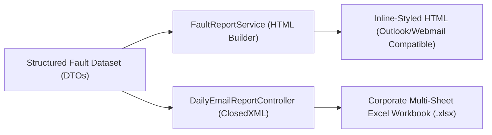

# Report 04: HTML & ClosedXML Excel Engines Deep Study
## Dual-Output Presentation Layer Architecture

---

## 1. Engine Overview

The presentation layer in `email report` generates two synchronized outputs from the same queried dataset:
1. **Interactive HTML Email Body**: Delivered via SMTP directly into the recipient's inbox.
2. **Formatted Excel Workbook (`.xlsx`)**: Built using ClosedXML, suitable for offline manipulation, filtering, and executive archiving.



---

## 2. HTML Email Engine Specification

### Corporate Color Palette (SLT NOC Theme)
```css
--brand-primary:   #1A3C5E; /* SLT Deep Corporate Navy */
--brand-secondary: #0066CC; /* Tech Cobalt Blue */
--brand-accent:    #0099FF; /* Highlight Sky Blue */
--status-critical: #E74C3C; /* Alarm Red */
--status-warning:  #F39C12; /* Warning Amber */
--status-ok:       #27AE60; /* Restored Green */
--bg-zebra:        #F8F9FA; /* Alternating Row Tint */
--border-color:    #E2E8F0; /* Soft Table Gridlines */
```

### Email Client Rendering Rules
To ensure compatibility across Microsoft Outlook (Desktop 2016/2019/365 using Microsoft Word rendering engine), Outlook Web App, Apple Mail, and mobile Gmail:
* **All styles are inline**: No external `<link>` stylesheets; `<style>` blocks provide responsive breakpoints only as enhancements.
* **Table-based grid structure**: Layouts are constructed with explicit HTML `<table>`, `<tr>`, and `<td>` tags with `cellpadding="0"` and `cellspacing="0"`.
* **Safe Fallback Typography**: `font-family: -apple-system, BlinkMacSystemFont, 'Segoe UI', Roboto, Helvetica, Arial, sans-serif;`.
* **Action Bar Integration**: Each email contains a prominent top banner featuring report metadata (Total Records, 07:00 AM Cutoff Timestamp, and SLT NOC Operational Contacts).

---

## 3. ClosedXML Excel Workbook Engine

ClosedXML was selected for spreadsheet generation because it builds native OpenXML (`.xlsx`) files in-memory without requiring Microsoft Excel to be installed on the server.

### Styling Standards Applied Across All Reports
1. **Title Banner**:
   * Merged top row spanning all columns.
   * Background: `#1A3C5E` (Navy), Font: Bold White, 14pt. Row height: 30pt.
2. **Metadata Subtitle**:
   * Merged row 2 displaying Snapshot Date, Cutoff Time (07:00 AM), Generation Timestamp, and Record Count.
   * Font: Italic, 10pt. Row height: 20pt.
3. **Column Headers**:
   * Background: `#2A5C8E` (Medium Navy), Font: Bold White, 10pt, Center-aligned.
   * Bottom border: Thick border. Row height: 26pt.
4. **Data Rows & Zebra Striping**:
   * Alternating row background: `#F8F9FA` for clean legibility.
   * Full thin border (`#D2D6DC`) applied to every data cell.
   * Automatic column auto-fit with minimum width of 10 and maximum width of 50.

### Multi-Sheet Structure in Type 4 Report
The Comprehensive Network Failure report generates a multi-sheet workbook containing 4 dedicated tabs:
1. **`MSAN Outages`**: All open MSAN Node Down events with IP addresses and durations.
2. **`4G Sites Down`**: Base station outages with eNodeB names and provinces.
3. **`Transmission Failures`**: Critical optical and DWDM link breaks.
4. **`Provincial Summary`**: Aggregated count matrix by Province and Platform.
