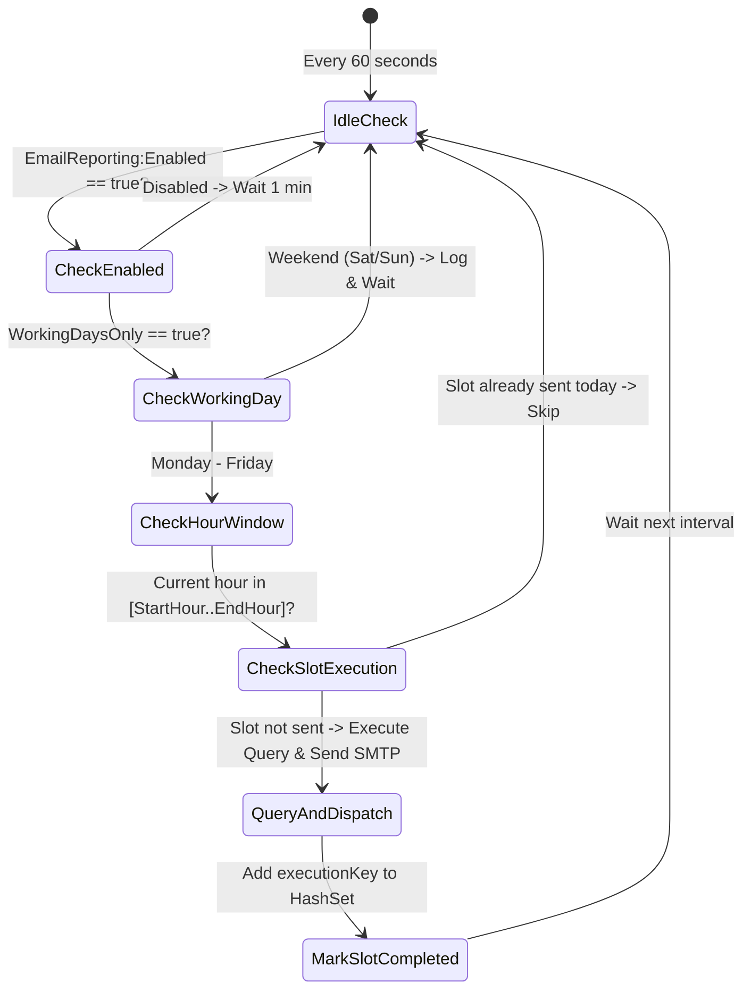

# Report 05: Automation Scheduler & Deployment Deep Study
## Operational Scheduling, Deduplication & Production Deployment

---

## 1. Automation Architecture

The email reporting automation engine is built to guarantee that every morning at **07:00 AM**, SLT NOC teams receive updated reports without human intervention or failure risks.



---

## 2. Deduplication & Schedule Guardrails

Inside [`DailyEmailReportSchedulerService.cs`](file:///D:/SLT_Projects/Project%2003/AlarmSystem_23062026/email%20report/Services/EmailReporting/DailyEmailReportSchedulerService.cs), three guardrails protect against duplicate emails and off-hours execution:

### 1. Unique Slot Deduplication
Each execution constructs an in-memory key:
```csharp
string executionKey = $"{now:yyyyMMdd}_{now.Hour:D2}_Type{reportType}";
```
If `executionKey` already exists in `executedSlots`, the report is skipped. This prevents duplicate sends if a clock check executes twice within the same hour window.

### 2. Midnight Rollover Crossover
At midnight, the service automatically clears the hash set:
```csharp
if (now.Date != lastCheckedDate)
{
    executedSlots.Clear();
    lastCheckedDate = now.Date;
    weekendNoticeLoggedToday = false;
}
```

### 3. Working Days Filter
When `WorkingDaysOnly` is enabled, the service checks the system day of week:
```csharp
bool isWorkingDay = now.DayOfWeek >= DayOfWeek.Monday && now.DayOfWeek <= DayOfWeek.Friday;
```
If it is Saturday or Sunday, dispatch is halted and a single informational log entry is recorded for the day.

---

## 3. Production Deployment Methods

### Method A: Windows Task Scheduler (Recommended Enterprise Approach)

Running via Windows Task Scheduler allows the application to execute as an ephemeral, reliable task without keeping a console window open 24/7.

#### Step 1: Publish the Release Binary
```powershell
cd "D:\SLT_Projects\Project 03\AlarmSystem_23062026\email report"
dotnet publish -c Release -o "C:\SLT_Services\EmailReport"
```

#### Step 2: Register the Scheduled Task via PowerShell (Run as Administrator)
```powershell
$TaskName = "SLT_NOC_DailyEmailReport"
$Executable = "C:\SLT_Services\EmailReport\EmailReport.exe"
$WorkingDir = "C:\SLT_Services\EmailReport"

# Action: Execute EmailReport.exe with argument --type all
$Action = New-ScheduledTaskAction -Execute $Executable -Argument "--type all" -WorkingDirectory $WorkingDir

# Trigger: 07:00 AM on Monday, Tuesday, Wednesday, Thursday, Friday
$Trigger = New-ScheduledTaskTrigger -Weekly -DaysOfWeek Monday, Tuesday, Wednesday, Thursday, Friday -At 07:00am

# Settings: Start task immediately if missed, retry 3 times on failure
$Settings = New-ScheduledTaskSettingsSet -AllowStartIfOnBatteries -DontStopIfGoingOnBatteries -StartWhenAvailable -RestartCount 3 -RestartInterval (New-TimeSpan -Minutes 5)

Register-ScheduledTask -TaskName $TaskName -Action $Action -Trigger $Trigger -Settings $Settings -Description "Automated 07:00 AM daily network fault reporting for SLT NOC"
```

---

### Method B: Continuous Windows Service

If you prefer a resident Windows background service running 24/7:

```powershell
# Create the service
New-Service -Name "SLTEmailReportService" `
            -BinaryPathName "C:\SLT_Services\EmailReport\EmailReport.exe" `
            -DisplayName "SLT NOC Email Reporting Daemon" `
            -Description "Background service checking schedule windows and dispatching daily fault reports" `
            -StartupType Automatic

# Start the service
Start-Service "SLTEmailReportService"
```

---

## 4. Complete CLI Automation Reference

| Command | Purpose |
| :--- | :--- |
| `dotnet run` | Run as continuous background scheduler daemon |
| `dotnet run -- --type 1` | Immediately dispatch Type 1 report via SMTP |
| `dotnet run -- --type 2` | Immediately dispatch Type 2 report via SMTP |
| `dotnet run -- --type 3` | Immediately dispatch Type 3 report via SMTP |
| `dotnet run -- --type 4` | Immediately dispatch Type 4 report via SMTP |
| `dotnet run -- --type all` | Immediately dispatch all 4 reports sequentially |
| `dotnet run -- --run-now` | Shorthand alias for `--type all` |
| `dotnet run -- --preview <1..4>` | Generate HTML preview file on disk |
| `dotnet run -- --export <1..4\|all>` | Generate ClosedXML Excel `.xlsx` file on disk |
| `dotnet run -- --generate-all` | Generate all 4 HTML files and all 4 Excel files into `docd/` |
| `dotnet run -- --out <path>` | Specify custom output folder for generated files |
| `dotnet run -- --help` | Display command-line options and usage syntax |
