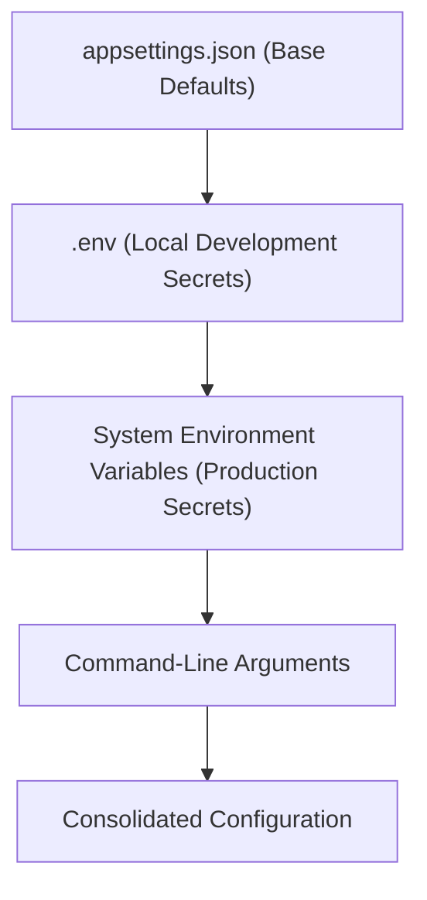

# Report 06: Configuration, Security & SMTP Deep Study
## System Parameters, Secret Management & Mail Transport

---

## 1. Configuration Architecture

The application loads configuration sequentially with the following precedence (highest priority wins):
1. **Command-line arguments** (e.g., `--out`, `--type`)
2. **Environment variables** (e.g., `EmailReporting__Smtp__Password`)
3. **Local `.env` file** (if present in working directory or app base path)
4. **`appsettings.Production.json` / `appsettings.Development.json`**
5. **`appsettings.json`**



---

## 2. Complete Configuration Reference

Below is the complete configuration template from [`appsettings.json`](file:///D:/SLT_Projects/Project%2003/AlarmSystem_23062026/email%20report/appsettings.json):

```json
{
  "Logging": {
    "LogLevel": {
      "Default": "Information",
      "Microsoft": "Warning",
      "Microsoft.Hosting.Lifetime": "Information"
    }
  },
  "ConnectionStrings": {
    "NewDB": "Server=localhost;Database=NewDB;Trusted_Connection=True;TrustServerCertificate=True;",
    "TMS": "Server=localhost;Database=NewDB;Trusted_Connection=True;TrustServerCertificate=True;"
  },
  "EmailReporting": {
    "AppBaseUrl": "http://localhost:5250",
    "Enabled": true,
    "WorkingDaysOnly": true,
    "StartHour": 7,
    "EndHour": 17,
    "IntervalHours": 1,
    "DefaultRecipient": "network.engineer@slt.com.lk",
    "Smtp": {
      "Host": "smtp.office365.com",
      "Port": 587,
      "Username": "noc-notifications@slt.com.lk",
      "Password": "",
      "EnableSsl": true,
      "FromAddress": "no-reply@slt.com.lk"
    },
    "Recipients": {
      "Default": "network.engineer@slt.com.lk",
      "NetworkEngineer": "network.engineer@slt.com.lk",
      "1": "regional.faults@slt.com.lk",
      "2": "opmc.faults@slt.com.lk",
      "3": "noc.faultmgmt@slt.com.lk",
      "4": "management.overview@slt.com.lk"
    },
    "Schedule": {
      "1": "07:00",
      "2": "07:00",
      "3": "07:00",
      "4": "07:00"
    }
  }
}
```

---

## 3. Secret Management & `.env` Isolation

To ensure SMTP passwords and database credentials are never committed into git:
* The `.gitignore` excludes all `.env` files while preserving [`.env.example`](file:///D:/SLT_Projects/Project%2003/AlarmSystem_23062026/email%20report/.env.example).
* Developers and server administrators configure credentials via a local `.env` file:

```ini
# Database Connection
ConnectionStrings__NewDB=Server=10.64.12.5;Database=NewDB;User Id=slt_noc;Password=SecurePassword123;TrustServerCertificate=True;

# Office 365 / Corporate SMTP
EmailReporting__Smtp__Host=smtp.office365.com
EmailReporting__Smtp__Port=587
EmailReporting__Smtp__Username=noc-report@slt.com.lk
EmailReporting__Smtp__Password=MySecretAppPassword
EmailReporting__Smtp__FromAddress=noc-report@slt.com.lk
EmailReporting__Smtp__EnableSsl=true

# Recipient Distribution Overrides
EmailReporting__Recipients__1=regional.engineers@slt.com.lk;provincial.dgm@slt.com.lk
EmailReporting__Recipients__2=opmc.supervisors@slt.com.lk
EmailReporting__Recipients__3=noc.fault.mgmt@slt.com.lk
EmailReporting__Recipients__4=chief.officer@slt.com.lk;gm.noc@slt.com.lk
```

---

## 4. SMTP Transport & Security Protocols

* **TLS/SSL Encryption**: Standard port 587 uses STARTTLS. The `SmtpClient` automatically upgrades unencrypted socket connections to TLS 1.2/1.3 upon issuing `EHLO`.
* **Multiple Recipients**: Recipient strings support semicolon (`;`) or comma (`,`) delimited lists. The engine automatically trims and validates each address.
* **Authentication**: Supports standard username/password credentials. For Office 365 accounts protected with Multi-Factor Authentication (MFA), an **App Password** or dedicated service mailbox must be configured.
