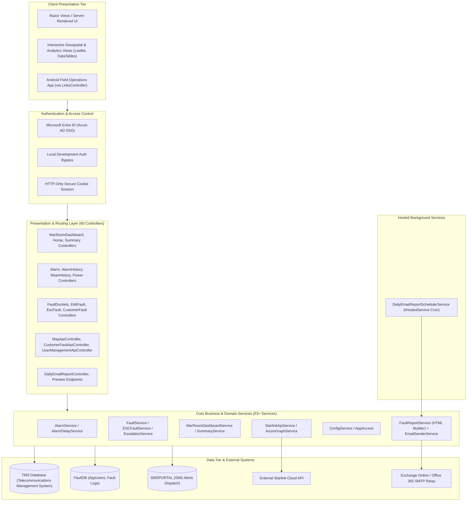
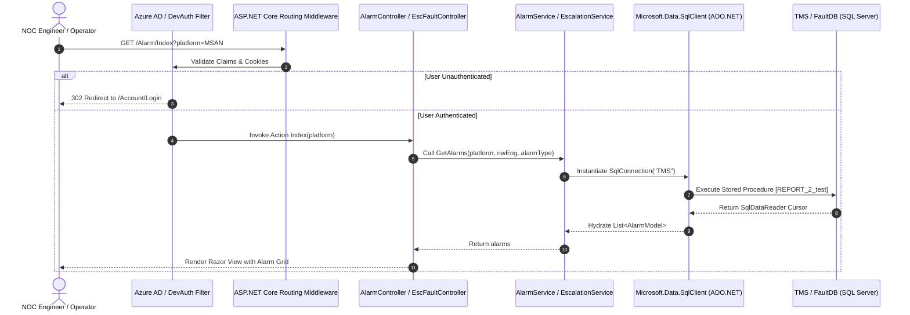

# 01. Project Overview & Architecture Analysis

## 1. Executive Summary

The **AlarmSystem** is an enterprise-grade Network Operations Center (NOC) monitoring, fault ticketing, alarm correlation, and operational automated reporting platform engineered for **Sri Lanka Telecom (SLT)**. Built targeting **.NET 10.0 (ASP.NET Core)**, the system unifies telemetry from diverse telecommunications infrastructures—including MSAN (Multi-Service Access Nodes), CEA (Customer Edge Access), ALU LTE/4G base stations, RTU clusters, OLT (Optical Line Terminals), and external satellite terminals (Starlink)—into a centralized dashboard, interactive geospatial map, and escalation engine.



---

## 2. High-Level Technical Specifications

| Component | Technical Details | Audit Notes |
| :--- | :--- | :--- |
| **Framework Target** | .NET 10.0 (`net10.0`, SDK `Microsoft.NET.Sdk.Web`) | Cutting-edge .NET release with C# 13/14 language features and enhanced runtime optimizations. |
| **Pattern** | MVC (Model-View-Controller) + RESTful Web APIs | Blended architecture: traditional server-rendered Razor views along with high-performance JSON API controllers. |
| **Data Access Pattern** | ADO.NET Direct (`Microsoft.Data.SqlClient`) | Raw SQL queries and stored procedures for extreme low-latency processing over telecom data volumes. |
| **Authentication** | Microsoft Identity Web (`Microsoft.Identity.Web` 3.5.0) | Azure AD / Entra ID OpenID Connect (OIDC) authentication with select-account prompts and cookie persistence. |
| **Development Bypass** | Environment-guarded Mock Identity Provider | In `Development`, allows instant auto-login (`DevAuth:BypassEnabled`) without reaching corporate Entra ID tenants. |
| **Reporting / Export** | ClosedXML (v0.105.0) + Native SMTP Client | High-speed OpenXML spreadsheet exports and multi-target HTML scheduled notifications. |

---

## 3. Core Business Objectives & Functional Modules

### 3.1 Fault & Incident Lifecycle Management
* **Docket Ingestion & Tracking**: Manages trouble tickets generated from automated network alarms and customer trouble reports ([`FaultDocketsController`](file:///D:/SLT_Projects/Project%2003/AlarmSystem_23062026/AlarmSystem/Controllers/FaultDocketsController.cs), [`FaultService`](file:///D:/SLT_Projects/Project%2003/AlarmSystem_23062026/AlarmSystem/Services/FaultService.cs)).
* **Multi-Tier Escalation Workflow**: Supports primary, secondary, and hierarchical team escalations across SLT regional centers, RTOMs, and OPMCs ([`EscalationService`](file:///D:/SLT_Projects/Project%2003/AlarmSystem_23062026/AlarmSystem/Services/EscalationService.cs), [`EscFaultController`](file:///D:/SLT_Projects/Project%2003/AlarmSystem_23062026/AlarmSystem/Controllers/EscFaultController.cs)).
* **Docket Comments & Audit Logs**: Real-time communication and timestamped activity logs attached to customer dockets.

### 3.2 Real-time Alarm Correlation & Device Monitoring
* **Multi-Platform Alarm Surveillance**: Real-time alarm monitoring spanning MSAN, CEA, DSLAM, ALU LTE, Power/Generator equipment, and Optical links ([`AlarmService`](file:///D:/SLT_Projects/Project%2003/AlarmSystem_23062026/AlarmSystem/Services/AlarmService.cs)).
* **Power & Battery Health Tracking**: Specifically monitors AC mains failures, generator run statuses, and LTE/MSAN battery backup discharge timers ([`ACMainFailureController`](file:///D:/SLT_Projects/Project%2003/AlarmSystem_23062026/AlarmSystem/Controllers/ACMainFailureController.cs), [`MsanBatteryBackupController`](file:///D:/SLT_Projects/Project%2003/AlarmSystem_23062026/AlarmSystem/Controllers/MsanBatteryBackupController.cs)).
* **Alarm Delay & Suppressions**: Logic to suppress transient flapping alarms and calculate service interruption windows ([`AlarmDelayService`](file:///D:/SLT_Projects/Project%2003/AlarmSystem_23062026/AlarmSystem/Services/AlarmDelayService.cs)).

### 3.3 Geospatial GIS Telemetry & Analytics
* **Interactive Mapping Platform**: Geospatial coordinate plotting of live network faults, carrier drops, and impacted customer clusters ([`MapApiController`](file:///D:/SLT_Projects/Project%2003/AlarmSystem_23062026/AlarmSystem/Controllers/MapApiController.cs)).
* **Carrier Impact Breakdowns**: Segregated fault analytics for enterprise carrier clients, wholesale leased lines, and regional provinces.

### 3.4 Automated Daily Executive & Operations Reporting
* **Background Scheduler**: Hosted background service ([`DailyEmailReportSchedulerService`](file:///D:/SLT_Projects/Project%2003/AlarmSystem_23062026/AlarmSystem/Services/EmailReporting/DailyEmailReportSchedulerService.cs)) running continuous schedule checks against configured dispatch windows.
* **4 Predefined Report Blueprints**:
  1. *Type 1 (08:00)*: Regional Network Teams pending data faults.
  2. *Type 2 (07:00)*: OPMC teams pending work orders.
  3. *Type 3 (00:15)*: SLT NOC Fault Management midnight status.
  4. *Type 4 (08:00)*: Full Network Failure Summary Report.
* **In-App Report Simulator**: Real-time HTML visualizer endpoint (`/preview-email`) allowing NOC supervisors to inspect generated tables prior to email transmission.

### 3.5 User Management & Role-Based Access Control (RBAC)
* Enterprise user governance backed by database-driven permissions ([`UserManagementApiController`](file:///D:/SLT_Projects/Project%2003/AlarmSystem_23062026/AlarmSystem/Controllers/UserManagementApiController.cs)).
* Integrates SLT Service IDs, Azure accounts, designated departments, and phone contact cards.

---

## 4. Dependencies & NuGet Libraries

The project maintains a lean dependency footprint focused on high throughput and minimal middleware overhead:

```xml
<ItemGroup>
  <!-- Excel workbook generation and streaming -->
  <PackageReference Include="ClosedXML" Version="0.105.0" />
  
  <!-- High performance SQL Server connectivity driver -->
  <PackageReference Include="Microsoft.Data.SqlClient" Version="6.1.4" />
  
  <!-- Design-time tooling support for EF migrations if needed -->
  <PackageReference Include="Microsoft.EntityFrameworkCore.Design" Version="10.0.12">
    <IncludeAssets>runtime; build; native; contentfiles; analyzers; buildtransitive</IncludeAssets>
    <PrivateAssets>all</PrivateAssets>
  </PackageReference>
  
  <!-- Microsoft Entra ID Authentication & OpenID Connect UI scaffolding -->
  <PackageReference Include="Microsoft.Identity.Web" Version="3.5.0" />
  <PackageReference Include="Microsoft.Identity.Web.UI" Version="3.5.0" />
</ItemGroup>
```

---

## 5. Architectural Flow & Layered Design (C4 Flowchart)

The following architectural model depicts the flow from client browser requests down to the physical database instances and third-party APIs:



---

## 6. Architectural Observations & Lead Auditor Summary

1. **High Performance Raw ADO.NET**: By utilizing direct `Microsoft.Data.SqlClient` calls and compiled stored procedures (`REPORT_2_test`, `usp_CustomerFault_Summary`, etc.), the system avoids the Object-Relational Mapping (ORM) overhead of Entity Framework Core, ensuring millisecond responses even under high volumes of alarm telemetry.
2. **Dual Database Segregation**: Operational telecom telemetry resides in the high-volume `TMS` database, while authentication and administrative records reside in `FaultDB`.
3. **Resilience & Fault Isolation**: The background scheduler runs asynchronously without blocking the Kestrel web thread pool, and dynamic preview endpoints allow debugging without triggering actual SMTP traffic.
