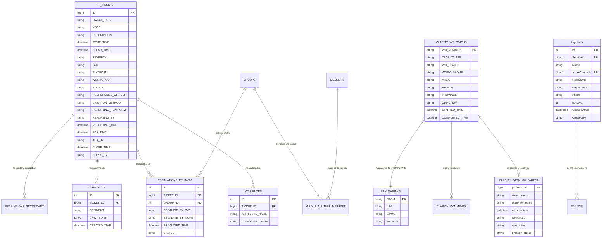

# 02. Database Schema & Migration Analysis

## 1. Executive Database Summary

The AlarmSystem ecosystem connects to three distinct SQL Server databases configured via [appsettings.json](file:///D:/SLT_Projects/Project%2003/AlarmSystem_23062026/AlarmSystem/appsettings.json):
1. **`TMS` (Telecommunications Management System)**: The primary telecom database containing over 80+ relational tables, tracking active tickets, clarity work orders, fault attributes, escalation trees, historical alarms, and physical network inventory.
2. **`FaultDB`**: Houses identity management, application governance, user profiles, and audit records ([`AppUsers_Migration.sql`](file:///D:/SLT_Projects/Project%2003/AlarmSystem_23062026/AlarmSystem/sql/AppUsers_Migration.sql)).
3. **`SMSPORTAL`**: SMS gateway dispatch integration tables.

---

## 2. Core Relational Schema & Entity Relationship Diagram

The primary operational tables in `TMS` and `FaultDB` interact as visualized below:



---

## 3. Deep Dive into Key Tables

### 3.1 Primary Telecom Ticketing (`T_TICKETS`, `ATTRIBUTES`, `COMMENTS`)
* **`T_TICKETS`**: Stores root fault and event tickets generated by monitoring agents or manual entry. Key lifecycle columns:
  - `STATUS`: State transitions (`OPEN` -> `ACKNOWLEDGED` -> `CLEARED` -> `CLOSED`).
  - `SEVERITY`: Criticality grading (`CRITICAL`, `MAJOR`, `MINOR`, `WARNING`).
  - `PLATFORM`: Source domain (`MSAN`, `CEA`, `ALU LTE`, `IPVPN`, `METRO`).
* **`ATTRIBUTES`**: EAV (Entity-Attribute-Value) extension table linking custom diagnostic properties (`CIRCUIT_ID`, `IP_ADDRESS`, `SLOT_PORT`, `POWER_STATUS`) to `TICKET_ID`.
* **`COMMENTS`**: Timestamped work history logs per ticket.

### 3.2 Clarity Integration Tables (`CLARITY_WO_STATUS`, `CLARITY_DATA_NW_FAULTS`, `CLARITY_COMMENTS`)
* Synchronizes data with SLT's Clarity OSS / CRM platform.
* Powers automated daily reports (Types 1, 2, 3, and 4) using `CLARITY_WO_STATUS.STARTED_TIME` and `CLARITY_DATA_NW_FAULTS.reportedtime` to measure pending complaint durations.

### 3.3 Escalation & Organizational Hierarchy
* **`GROUPS` & `MEMBERS`**: Configures tiered escalation groups (e.g., *CEN-CSC-DATA*, *NOC-CORE*, *TRANSMISSION-METRO*).
* **`GROUP_MEMBER_MAPPING`**: Connects telecommunication engineers to workgroups with assigned contact phone numbers and notification priority.
* **`ESCALATIONS_PRIMARY` / `ESCALATIONS_SECONDARY`**: Tracks active escalation dispatches, responsible engineers, and acknowledgment timestamps.

### 3.4 Power & Infrastructure Health
* **`REPORT_ACMAIN`**: Logs AC power loss occurrences at exchanges and remote telecom towers.
* **`BATTERY_BACKUP_2` & `BATTERY_BACKUP_NO_PRIOR_AC_MAIN`**: Discharges and run-time remaining calculations for battery bank backups.
* **`REF_GENERATOR`**: Tracks diesel generator activation and fuel reserves during utility outages.

### 3.5 Identity Governance (`FaultDB.dbo.AppUsers`)
Engineered through [AppUsers_Migration.sql](file:///D:/SLT_Projects/Project%2003/AlarmSystem_23062026/AlarmSystem/sql/AppUsers_Migration.sql):
* `ServiceId` (`NVARCHAR(6)`, Unique Index): Matches the 6-digit SLT employee identification number.
* `AzureAccount` (`NVARCHAR(200)`, Unique Index): Microsoft Entra ID principal name / corporate email.
* `RoleName` (`NVARCHAR(40)`): Role authorization label (`Admin`, `Engineer`, `Operator`, `Viewer`).

---

## 4. Database Indexing & Performance Analysis

### 4.1 Filtered Unique Indexes
The migration script [AppUsers_Migration.sql](file:///D:/SLT_Projects/Project%2003/AlarmSystem_23062026/AlarmSystem/sql/AppUsers_Migration.sql) establishes filtered indexes to allow nullable fields while enforcing absolute uniqueness when populated:
```sql
CREATE UNIQUE INDEX UX_AppUsers_ServiceId ON dbo.AppUsers(ServiceId)
WHERE ServiceId IS NOT NULL;

CREATE UNIQUE INDEX UX_AppUsers_AzureAccount ON dbo.AppUsers(AzureAccount)
WHERE AzureAccount IS NOT NULL;
```

### 4.2 Query Optimization in Daily Reports
As evidenced in [EmailReport_Queries.sql](file:///D:/SLT_Projects/Project%2003/AlarmSystem_23062026/AlarmSystem/sql/EmailReport_Queries.sql):
* Critical joins link `CLARITY_WO_STATUS.CLARITY_REF` with `CLARITY_DATA_NW_FAULTS.problem_no`.
* **Auditor Recommendation**: Ensure non-clustered composite indexes exist on:
  - `dbo.CLARITY_WO_STATUS (WO_STATUS, STARTED_TIME) INCLUDE (CLARITY_REF, CIRCUIT, WORK_GROUP, REGION, PROVINCE)`
  - `dbo.CLARITY_DATA_NW_FAULTS (problem_no, problem_status, reportedtime)`

---

## 5. Step-by-Step Database Setup & Restore Guide

### Step 1: Restore `FaultDB` Backup
The repository includes a ready-to-restore database snapshot [FaultDB.bak](file:///D:/SLT_Projects/Project%2003/AlarmSystem_23062026/AlarmSystem/FaultDB.bak) (94.9 MB). Execute in SQL Server Management Studio (SSMS) or SQLCMD:

```sql
USE [master];
GO

RESTORE DATABASE [FaultDB]
FROM DISK = N'D:\SLT_Projects\Project 03\AlarmSystem_23062026\AlarmSystem\FaultDB.bak'
WITH 
    MOVE N'FaultDB' TO N'C:\Program Files\Microsoft SQL Server\MSSQL16.MSSQLSERVER\MSSQL\DATA\FaultDB.mdf',
    MOVE N'FaultDB_log' TO N'C:\Program Files\Microsoft SQL Server\MSSQL16.MSSQLSERVER\MSSQL\DATA\FaultDB_log.ldf',
    REPLACE,
    STATS = 10;
GO
```

### Step 2: Apply User Management Schema Migrations
Execute the [AppUsers_Migration.sql](file:///D:/SLT_Projects/Project%2003/AlarmSystem_23062026/AlarmSystem/sql/AppUsers_Migration.sql) script against the restored `FaultDB`:

```powershell
sqlcmd -S localhost -d FaultDB -i "D:\SLT_Projects\Project 03\AlarmSystem_23062026\AlarmSystem\sql\AppUsers_Migration.sql"
```

### Step 3: Initialize the `TMS` Database
Execute the main schema build script [TMS_Script.sql](file:///D:/SLT_Projects/Project%2003/AlarmSystem_23062026/AlarmSystem/TMS_Script.sql) (UTF-16 LE encoded):

```powershell
sqlcmd -S localhost -i "D:\SLT_Projects\Project 03\AlarmSystem_23062026\AlarmSystem\TMS_Script.sql"
```

### Step 4: Verify Connectivity and Health
Test connectivity from PowerShell using SqlClient or test scripts:

```powershell
$conn = New-Object Microsoft.Data.SqlClient.SqlConnection("Server=localhost;Database=TMS;Trusted_Connection=True;TrustServerCertificate=True;")
$conn.Open()
Write-Host "TMS Connection State:" $conn.State
$conn.Close()
```
