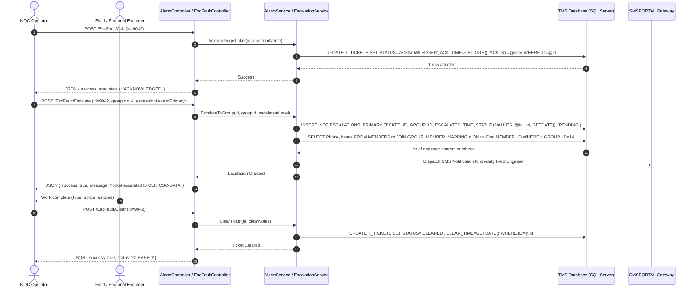

# 03. API Endpoints and Routing Catalog

## 1. Overview of Application Routing

The **AlarmSystem** application incorporates 60 Controller classes exposing 156 route actions. The application features a hybrid routing pattern:
1. **RESTful Web APIs**: Prefixed under `/api/*`, utilizing `[ApiController]` attributes, consuming and producing JSON payloads for AJAX dashboards and Leaflet mapping layers.
2. **MVC Server-Rendered Actions**: Standard pattern `{controller=Home}/{action=Index}/{id?}` returning Razor views or streaming OpenXML spreadsheet files (`ClosedXML`).
3. **Minimal API Endpoints**: Registered directly in [Program.cs](file:///D:/SLT_Projects/Project%2003/AlarmSystem_23062026/AlarmSystem/Program.cs#L175-L179) for dynamic email report simulation (`/preview-email`).

---

## 2. End-to-End Workflow Sequence: Fault Escalation & Alarm Clearance

The following sequence diagram illustrates the critical path when an active network alarm requires investigation, escalation to regional engineering teams, and eventual clearance:

---

## 3. Comprehensive Controller & Endpoint Mapping Table

The table below catalogs the audited controllers, HTTP methods, path routes, parameters, and return signatures across the codebase:

### 3.1 RESTful Web APIs (`/api/*`)

| Controller | HTTP Method | Route Path | Request Payload / Query Params | Response Type | Description |
| :--- | :--- | :--- | :--- | :--- | :--- |
| **`UserManagementApiController`** | `GET` | `/api/usermanagement/users` | `?search=string&top=int` | `Ok({count, rows: UserRecordDto[]})` | Retrieves system users with filtering |
| **`UserManagementApiController`** | `GET` | `/api/usermanagement/users/{id:int}` | Route `id: int` | `Ok(UserRecordDto)` / `NotFound` | Loads user by primary ID |
| **`UserManagementApiController`** | `POST` | `/api/usermanagement/users` | Body `CreateUserRequest` (ServiceId, Name, AzureAccount, RoleName, etc.) | `CreatedAtAction` / `BadRequest` | Creates a new user in `FaultDB` |
| **`UserManagementApiController`** | `PUT` | `/api/usermanagement/users/{id:int}` | Route `id: int`, Body `UpdateUserRequest` | `Ok(UserRecordDto)` / `BadRequest` | Updates user details and permissions |
| **`UserManagementApiController`** | `DELETE` | `/api/usermanagement/users/{id:int}` | Route `id: int` | `Ok({message})` / `NotFound` | Soft-deletes / removes user |
| **`CustomerFaultApiController`** | `GET` | `/api/customerfault/summary` | `?from=date&to=date&region=str&province=str&top=int` | `Ok(CustomerFaultSummaryDto)` | Summary statistics & recent customer faults |
| **`CustomerFaultApiController`** | `GET` | `/api/customerfault/mapdata-all` | `?from=date&to=date&search=str&region=str&province=str&top=int` | `Ok(List<MapFaultDto>)` | Geospatial coordinate feed for map display |
| **`CustomerFaultApiController`** | `GET` | `/api/customerfault/list` | `?from=date&to=date&search=str&region=str&province=str&top=int` | `Ok({count, rows})` | Paginated customer fault dockets |
| **`CustomerFaultApiController`** | `GET` | `/api/customerfault/mapdata` | `?from=date&to=date&search=str&carrier=str&region=str` | `Ok(List<MapFaultDto>)` | Filtered map dataset by carrier |
| **`MapApiController`** | `GET` | `/api/map/faults` | `?from=date&to=date&carrier=str&search=str&customerFault=bool` | `Ok(List<MapFaultItem>)` | Core geospatial map nodes and coordinates |
| **`MapApiController`** | `GET` | `/api/map/faults_all` | `?from=date&to=date&carrier=str&search=str&top=2000` | `Ok(List<MapFaultItem>)` | Extended unpaginated map fault telemetry |
| **`MapApiController`** | `GET` | `/api/map/carrier-counts` | `?from=date&to=date&carrier=str&search=str` | `Ok(CarrierCountsDto)` | Carrier fault distribution counts |
| **`MapApiController`** | `GET` | `/api/map/region-province-options` | None | `Ok(RegionProvinceOptionsDto)` | Lookup options for UI dropdowns |
| **`ViewDataApiController`** | `GET` | `/api/viewdata/section/{sectionKey}` | Route `sectionKey: str`, `?search=str&top=int` | `Ok({columns, rows})` | Dynamic generic table viewer |
| **`ViewDataApiController`** | `POST` | `/api/viewdata/section/{sectionKey}` | Route `sectionKey`, Body `AddSectionRowRequest` | `Ok({id})` / `BadRequest` | Dynamically inserts row into table |
| **`ViewDataApiController`** | `PUT` | `/api/viewdata/section/{sectionKey}` | Route `sectionKey`, Body `UpdateSectionRowRequest` | `Ok({message})` | Updates row in generic table |
| **`ViewDataApiController`** | `DELETE` | `/api/viewdata/section/{sectionKey}` | Route `sectionKey`, Body `DeleteSectionRowRequest` | `Ok({message})` | Deletes row from generic table |
| **`StarlinkController`** | `POST` | `/api/starlink/test` | Body `ApiTestRequest` | `Ok(ApiTestResponse)` | Tests Starlink OAuth and ping diagnostics |
| **Program.cs (Minimal API)** | `GET` | `/preview-email` | `?type=int&date=datetime` | `ContentResult` (`text/html`) | Renders live preview of daily email reports |

---

### 3.2 Authentication & Session Routing

| Controller | HTTP Method | Route Path | Parameters | Response Type | Description |
| :--- | :--- | :--- | :--- | :--- | :--- |
| **`AccountController`** | `GET` | `/Account/Login` | `string? returnUrl` | `ViewResult` / `Redirect` | Displays login view or redirects if active |
| **`AccountController`** | `POST` | `/Account/Login` | `username, password, returnUrl` | `RedirectToAction("SignIn")` | Submits login form to Azure AD flow |
| **`AccountController`** | `POST` | `/Account/DevBypassLogin` | `string? returnUrl` | `SignInResult` | In `Development`, signs in mock dev principal |
| **`AccountController`** | `GET/POST`| `/Account/SignIn` | `string? returnUrl` | `ChallengeResult` (OIDC) | Initiates Entra ID OpenID Connect challenge |
| **`AccountController`** | `GET/POST`| `/Account/Logout` | None | `RedirectToAction("Login")` | Invalidates cookies and terminates session |
| **`AccountController`** | `GET` | `/Account/AccessDenied` | None | `RedirectToAction("Login")` | Redirects unauthorized attempts |

---

### 3.3 Core Operations & Alarm Management

| Controller | HTTP Method | Route Path | Parameters | Response Type | Description |
| :--- | :--- | :--- | :--- | :--- | :--- |
| **`AlarmController`** | `GET` | `/Alarm/Index` | `platform="~ALL~", nwEng="~ALL~", alarmType="~ALL~"` | `ViewResult` | Master alarm list grid |
| **`AlarmController`** | `GET` | `/Alarm/Details` | `int id` | `ViewResult` | Displays specific alarm diagnostics |
| **`AlarmController`** | `POST` | `/Alarm/Close` | `int id` | `IActionResult` | Resolves and closes alarm |
| **`AlarmController`** | `POST` | `/Alarm/CreateEscalation` | `int id` | `IActionResult` | Creates escalation ticket from alarm |
| **`AlarmController`** | `GET` | `/Alarm/ExportToExcel` | `platform, nwEng, alarmType` | `FileResult` (`.xlsx`) | Streams Excel spreadsheet via ClosedXML |
| **`EscFaultController`** | `GET` | `/EscFault/Details` | `long id` | `ViewResult` | Displays escalated ticket status & logs |
| **`EscFaultController`** | `POST` | `/EscFault/Ack` | `long id` | `JsonResult` | Acknowledges escalated ticket |
| **`EscFaultController`** | `POST` | `/EscFault/Clear` | `long id` | `JsonResult` | Clears fault status |
| **`EscFaultController`** | `POST` | `/EscFault/Close` | `long id` | `JsonResult` | Formally closes ticket docket |
| **`EscFaultController`** | `GET` | `/EscFault/GetChildGroups` | `long parentId` | `JsonResult` | Hierarchical escalation group selector |
| **`EscFaultController`** | `POST` | `/EscFault/AddComment` | `long id, string newComment` | `JsonResult` | Appends comment to docket |
| **`EscFaultController`** | `POST` | `/EscFault/Escalate` | `long id, long groupId, string escalationLevel` | `JsonResult` | Executes multi-tier escalation |
| **`EditFaultController`** | `GET` | `/EditFault/Index` | `long id` | `ViewResult` | Edit fault form interface |
| **`EditFaultController`** | `POST` | `/EditFault/UpdateTags` | `long id, string tag` | `RedirectToAction` | Updates ticket tagging classification |
| **`EditFaultController`** | `POST` | `/EditFault/UpdateOfficer`| `long id, string officer` | `RedirectToAction` | Reassigns responsible officer |
| **`FaultDocketsController`**| `GET` | `/FaultDockets/Index` | `customerType="~ALL~", workGroup="~ALL~"` | `ViewResult` | Active customer fault dockets |
| **`FaultDocketsController`**| `GET` | `/FaultDockets/Details` | `int id` | `ViewResult` | Detailed Clarity docket views |
| **`FaultDocketsController`**| `GET` | `/FaultDockets/Export` | None | `FileResult` (`.xlsx`) | Exports dockets to Excel |
| **`NewTicketController`** | `GET` | `/NewTicket/Create` | `long? level3, long? level2` | `ViewResult` | Manual ticket creation screen |
| **`NewTicketController`** | `POST` | `/NewTicket/Create` | `TicketCreateViewModel vm` | `RedirectToAction` / `ViewResult` | Saves new ticket and dispatches triggers |

---

### 3.4 Operational Dashboards & History

| Controller | HTTP Method | Route Path | Parameters | Response Type | Description |
| :--- | :--- | :--- | :--- | :--- | :--- |
| **`HomeController`** | `GET` | `/Home/Index` | None | `ViewResult` | Landing portal / Main overview |
| **`HomeController`** | `GET` | `/Home/Dashboard` | None | `ViewResult` | NOC Executive Operational Dashboard |
| **`HomeController`** | `GET` | `/Home/AlarmDashboard` | `DateTime? from, DateTime? to` | `ViewResult` | Live alarm surveillance summary |
| **`HomeController`** | `GET` | `/Home/CustomerFaults` | None | `ViewResult` | Real-time customer complaint map & list |
| **`HomeController`** | `GET` | `/Home/RealtimeAlarm` | None | `ViewResult` | High-frequency telemetry stream page |
| **`WarRoomDashboardController`** | `GET` | `/WarRoomDashboard/Index` | None | `ViewResult` | Critical incident NOC War Room monitor |
| **`ACMainFailureController`**| `GET` | `/ACMainFailure/Index` | `from, to, platform, nwEng` | `ViewResult` | Power AC grid outages tracker |
| **`ACMainFailureController`**| `GET` | `/ACMainFailure/Export` | `from, to, platform, nwEng` | `FileResult` (`.xlsx`) | Power outages spreadsheet |
| **`MsanBatteryBackupController`**| `GET`| `/MsanBatteryBackup/Index` | None | `ViewResult` | Battery remaining runtime alarms |
| **`MsanHistoryController`** | `GET` | `/MsanHistory/Index` | `from, to, nwEng` | `ViewResult` | Historical MSAN failure audit logs |
| **`HistoryController`** | `GET` | `/History/Index` | `ticketType, from, to` | `ViewResult` | Master ticket history search |
| **`DailyEmailReportController`**| `GET`| `/DailyEmailReport/Index`| None | `ViewResult` | Email dispatch configuration & test |
| **`DailyEmailReportController`**| `GET`| `/DailyEmailReport/Preview`| `int type, DateTime? date` | `ContentResult` (`text/html`) | HTML email report preview |
