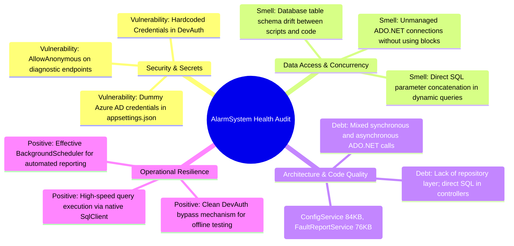
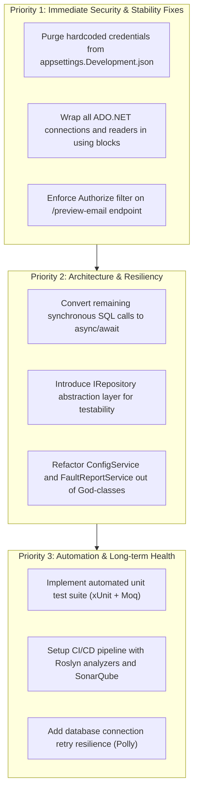

# 04. Project Status, Bugs, and Technical Debt Audit

## 1. Executive Quality & Audit Assessment

This audit evaluates the codebase health across security, architecture, exception handling, data hygiene, and maintainability.



---

## 2. Completed Features vs. Pending Work

| Feature / Domain | Implementation State | Verification Notes |
| :--- | :--- | :--- |
| **Azure AD Authentication** | ✅ Implemented | Configured via `Microsoft.Identity.Web` with OIDC cookie persistence. |
| **Development Auth Bypass** | ✅ Implemented | Allows developers to mock an authenticated session locally via `DevBypassLogin`. |
| **Realtime Alarm Monitoring** | ✅ Implemented | Stored procedure execution and multi-filtering across MSAN, CEA, and LTE domains. |
| **Daily Email Reporting** | ✅ Implemented | Types 1 through 4 automated HTML reports driven by `IHostedService`. |
| **Excel Export Capability** | ✅ Implemented | Streaming `.xlsx` exports powered by ClosedXML across alarm, power, and docket tables. |
| **Interactive Map Telemetry** | ✅ Implemented | GeoJSON/coordinate serialization via `MapApiController` for Leaflet mapping. |
| **User Management API** | 🟡 Partial | Stored procedures and endpoints are written, but depends on `AppUsers_Migration.sql` execution. |
| **Starlink Integration** | 🟡 In-Progress | Models and auth client exist (`StarlinkController`, `StarlinkAuthService`), but API credentials and endpoints are blank. |
| **Automated Unit Testing** | ❌ Not Implemented | No xUnit, NUnit, or MSTest test suite exists in the repository. |
| **Repository Abstraction** | ❌ Not Implemented | Controllers frequently instantiate or invoke raw SQL queries directly instead of through interfaces. |

---

## 3. High-Priority Bugs, Security Vulnerabilities & Code Smells

### 3.1 Hardcoded Secrets in Source Code & Configurations
* **Issue**: [appsettings.Development.json](file:///D:/SLT_Projects/Project%2003/AlarmSystem_23062026/AlarmSystem/appsettings.Development.json#L12) contains a hardcoded password string (`"DefaultPassword": "Gaya187172"`) and internal corporate email address (`testuser008@intranet.slt.com.lk`).
* **Risk**: High risk of credential exposure if committed to public repositories.
* **Remediation**:
  1. Remove password values from development settings.
  2. Use .NET Secret Manager (`dotnet user-secrets`) during local development and Azure Key Vault in production.

### 3.2 Unmanaged ADO.NET Connections & Connection Leaks
* **Issue**: In several legacy services ([`FaultService.cs`](file:///D:/SLT_Projects/Project%2003/AlarmSystem_23062026/AlarmSystem/Services/FaultService.cs#L27-L60)), database connections and readers are opened manually without wrapping inside `using` statements:
  ```csharp
  // Antipattern in FaultService.cs:
  _connection.Open();
  SqlDataReader dr = cmd.ExecuteReader();
  // If an exception occurs here, dr and _connection are never disposed!
  dr.Close();
  _connection.Close();
  ```
* **Risk**: Under high concurrent load at the NOC, an unhandled exception will cause connection pool exhaustion, leading to application crashes (`Timeout expired. The timeout period elapsed prior to obtaining a connection from the pool`).
* **Remediation**: Enforce `using var conn = ...` and `using var reader = ...` across all database services.

### 3.3 Synchronous Blocking in Async Pipelines
* **Issue**: In [Program.cs](file:///D:/SLT_Projects/Project%2003/AlarmSystem_23062026/AlarmSystem/Program.cs#L188), `Thread.Sleep(500)` is invoked in the graceful shutdown registration. In controllers, synchronous methods (`.Open()`, `.ExecuteReader()`) are mixed with async action methods (`async Task<IActionResult>`).
* **Risk**: Thread pool starvation, reduced Kestrel throughput, and delayed request processing.
* **Remediation**: Standardize entirely on asynchronous database operations (`OpenAsync()`, `ExecuteReaderAsync()`, `ExecuteNonQueryAsync()`).

### 3.4 Overly Permissive Anonymous Access to Internal Data
* **Issue**: The email preview endpoint in [Program.cs](file:///D:/SLT_Projects/Project%2003/AlarmSystem_23062026/AlarmSystem/Program.cs#L179) includes `.AllowAnonymous()`:
  ```csharp
  app.MapGet("/preview-email", async (...) => { ... }).AllowAnonymous();
  ```
* **Risk**: Anyone with network access to port 5203 can view confidential internal network outage data and customer names without authenticating.
* **Remediation**: Remove `.AllowAnonymous()` and require NOC operational authorization claims.

### 3.5 Massive "God-Class" Architectures
* **Issue**:
  - [`ConfigService.cs`](file:///D:/SLT_Projects/Project%2003/AlarmSystem_23062026/AlarmSystem/Services/ConfigService.cs): 84.6 KB containing dozens of unrelated queries.
  - [`FaultReportService.cs`](file:///D:/SLT_Projects/Project%2003/AlarmSystem_23062026/AlarmSystem/Services/FaultReportService/FaultReportService.cs): 76.7 KB mixing HTML string templating with raw database queries.
* **Risk**: Violates the Single Responsibility Principle (SRP); refactoring or updating HTML templates risks breaking database extraction.
* **Remediation**: Extract reporting templates into Razor View-to-String renderers or dedicated Fluid/Scriban template files.

---

## 4. Prioritized Action Plan & Technical Roadmap


