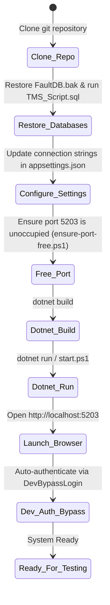

# 05. Setup and Deployment Guide

## 1. Developer Onboarding & Environment Prerequisites

Before running the **AlarmSystem** locally, ensure your workstation satisfies the following software and environment requirements:

| Component | Minimum Version | Recommended / Verified | Purpose |
| :--- | :--- | :--- | :--- |
| **Operating System** | Windows 10 (Build 19041+) / Windows 11 | Windows 11 Pro / Enterprise | Required for native Windows authentication and local IIS/Kestrel hosting. |
| **.NET SDK** | .NET 10.0 SDK | .NET 10.0.100+ | Application target runtime and C# compiler. |
| **Database Engine** | Microsoft SQL Server 2019+ | SQL Server 2022 Express / Developer Edition | Hosts `TMS`, `FaultDB`, and `SMSPORTAL`. |
| **Management Tools**| SQL Server Management Studio (SSMS) v19+ | SSMS or Azure Data Studio | For running restore operations and executing schema migrations. |
| **IDE / Editor** | Visual Studio 2022 (v17.12+) / VS Code | Visual Studio 2022 with ASP.NET & Web Development workload | Solution file support (`AlarmSystem.slnx`). |

---

## 2. Local Environment Setup & Execution Workflow

The following state diagram illustrates the developer onboarding and execution lifecycle:



---

## 3. Step-by-Step Execution Guide

### Step 1: Database Initialization
1. Open PowerShell as Administrator or launch SSMS.
2. Restore the pre-built `FaultDB` snapshot from the root folder:
   ```sql
   RESTORE DATABASE [FaultDB]
   FROM DISK = N'D:\SLT_Projects\Project 03\AlarmSystem_23062026\AlarmSystem\FaultDB.bak'
   WITH REPLACE, STATS = 10;
   ```
3. Run the user management migration script against `FaultDB`:
   ```powershell
   sqlcmd -S localhost -d FaultDB -i "sql\AppUsers_Migration.sql"
   ```
4. Create and populate the `TMS` schema:
   ```powershell
   sqlcmd -S localhost -i "TMS_Script.sql"
   ```

---

### Step 2: Configuration Binding & Secrets Management
Review [appsettings.json](file:///D:/SLT_Projects/Project%2003/AlarmSystem_23062026/AlarmSystem/appsettings.json) and verify connection strings:

```json
{
  "ConnectionStrings": {
    "TMS": "Server=localhost;Database=TMS;Trusted_Connection=True;TrustServerCertificate=True;",
    "FaultDb": "Server=localhost;Database=FaultDB;Trusted_Connection=True;TrustServerCertificate=True;",
    "SmsDb": "Server=localhost;Database=SMSPORTAL;Trusted_Connection=True;TrustServerCertificate=True;"
  },
  "Kestrel": {
    "Endpoints": {
      "Http": {
        "Url": "http://localhost:5203"
      }
    }
  }
}
```

In development environments, verify that [appsettings.Development.json](file:///D:/SLT_Projects/Project%2003/AlarmSystem_23062026/AlarmSystem/appsettings.Development.json) has `DevAuth.BypassEnabled` set to `true`:
```json
{
  "DevAuth": {
    "BypassEnabled": true,
    "DefaultUsername": "testuser008@intranet.slt.com.lk",
    "DisplayName": "Test User 008",
    "EmployeeId": "012264"
  }
}
```

---

### Step 3: Resolving Port Binding Conflicts
The application binds strictly to port `5203`. If an earlier instance or orphan process holds this port, run the included utility script [scripts/ensure-port-free.ps1](file:///D:/SLT_Projects/Project%2003/AlarmSystem_23062026/AlarmSystem/scripts/ensure-port-free.ps1):

```powershell
powershell -ExecutionPolicy Bypass -File .\scripts\ensure-port-free.ps1
```

---

### Step 4: Building and Running the Application
Use either the quick-launch script [start.ps1](file:///D:/SLT_Projects/Project%2003/AlarmSystem_23062026/AlarmSystem/start.ps1) or the .NET CLI:

```powershell
# Restore dependencies and build
dotnet build

# Launch Kestrel server in Development mode
$env:ASPNETCORE_ENVIRONMENT="Development"
dotnet run
```

---

### Step 5: Verification & Smoke Testing
1. Open your browser and navigate to `http://localhost:5203`.
2. The browser redirects to `/Account/Login`. With `BypassEnabled: true`, click the **Development Bypass Login** button to automatically obtain a development session without connecting to Microsoft Entra ID.
3. Access the primary operational views:
   - **War Room Dashboard**: `http://localhost:5203/WarRoomDashboard/Index`
   - **Live Alarm Grid**: `http://localhost:5203/Alarm/Index`
   - **Customer Fault Telemetry**: `http://localhost:5203/Home/CustomerFaults`
   - **Email Preview Simulator**: `http://localhost:5203/preview-email?type=1`

---

## 4. Production Deployment Considerations

### 4.1 Reverse Proxy & IIS / Linux Setup
In enterprise production deployments, do not expose Kestrel directly to the internet:
* **Windows Server (IIS)**: Deploy using ASP.NET Core In-Process Hosting (`AspNetCoreModuleV2`).
* **Linux (RHEL / Ubuntu)**: Run behind NGINX or HAProxy with `X-Forwarded-For` and `X-Forwarded-Proto` header forwarding enabled.

### 4.2 Production Security Hardening
1. **Disable Development Bypass**: Ensure `ASPNETCORE_ENVIRONMENT` is set to `Production` to disable the `DevBypassLogin` endpoint in `AccountController`.
2. **Azure AD Enterprise Registration**:
   - Register the application in Microsoft Entra ID.
   - Configure redirect URIs matching production domains (`https://alarms.slt.com.lk/signin-oidc`).
   - Store Azure AD `ClientSecret` and SMTP passwords in **Azure Key Vault** or Environment Variables instead of `appsettings.json`.
3. **Database Connection Hardening**:
   - Change connection strings to use least-privilege SQL service accounts instead of full admin privileges.
   - Remove `TrustServerCertificate=True` in production by deploying trusted TLS certificates to SQL Server instances.
