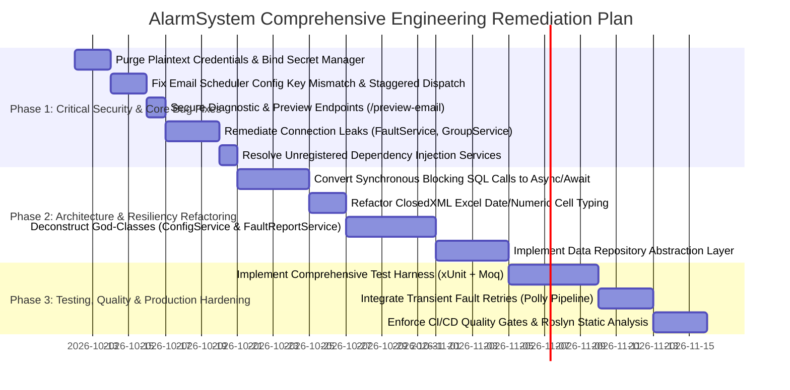
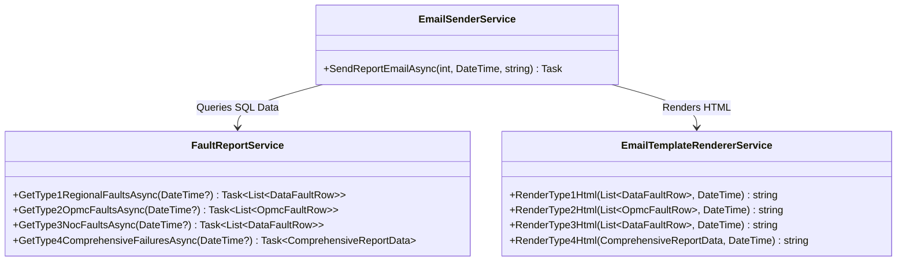
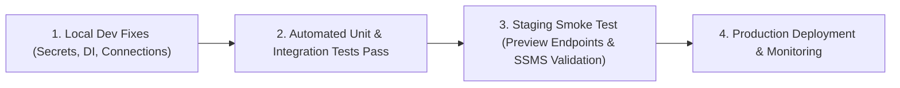

# 07. Remediation and Engineering Action Plan

## 1. Executive Remediation Strategy

This document outlines a prioritized, production-grade engineering remediation plan designed to address the vulnerabilities, architectural flaws, bugs, performance bottlenecks, and technical debt identified across the **AlarmSystem** codebase.



---

## 2. Phase 1: Critical Security & Core Bug Fixes (Sprint 1)

### 1.1 Purge Hardcoded Secrets & Implement Secret Management
* **Target Files**: 
  - [`appsettings.Development.json`](file:///D:/SLT_Projects/Project%2003/AlarmSystem_23062026/AlarmSystem/appsettings.Development.json#L11-L15)
  - [`appsettings.json`](file:///D:/SLT_Projects/Project%2003/AlarmSystem_23062026/AlarmSystem/appsettings.json#L47-L48)
* **Problem**: 
  - Plaintext password (`"DefaultPassword": "Gaya187172"`) and internal SLT corporate email address (`testuser008@intranet.slt.com.lk`) are committed directly into source code.
  - In `appsettings.json`, placeholder client secrets (`dummy-client-secret`) pose risks of credential leakage if accidentally replaced and committed.
* **Remediation Steps**:
  1. Purge `DefaultPassword` and production credentials from `appsettings.Development.json`.
  2. Initialize .NET Secret Manager for local developer environments:
     ```powershell
     dotnet user-secrets init
     dotnet user-secrets set "DevAuth:DefaultPassword" "LocalSecureDevPassword!"
     dotnet user-secrets set "EmailReporting:Smtp:Username" "noc-notifications@slt.com.lk"
     dotnet user-secrets set "EmailReporting:Smtp:Password" "AppPasswordSecret"
     dotnet user-secrets set "AzureAd:ClientSecret" "EntraClientSecretKey"
     ```
  3. Ensure production environments read credentials strictly from Azure Key Vault or container environment variables (`EMAILREPORTING__SMTP__PASSWORD`).
* **Verification & Acceptance Criteria**: Run `git diff` and static scanner (`trufflehog` / `gitleaks`) to verify zero credential patterns exist in git history.

---

### 1.2 Fix Email Scheduler Config Key Mismatch & Staggered Dispatch
* **Target File**: [`DailyEmailReportSchedulerService.cs`](file:///D:/SLT_Projects/Project%2003/AlarmSystem_23062026/AlarmSystem/Services/EmailReporting/DailyEmailReportSchedulerService.cs#L40-L100)
* **Root Cause Analysis**:
  1. **Config Key Mismatch**: In `DailyEmailReportSchedulerService.cs` line 44, the code reads `scheduleConfig[$"Type{reportType}"]`. However, `appsettings.json` configures dictionary keys as `"1"`, `"2"`, `"3"`, `"4"`. Thus `scheduleConfig["Type1"]` returns `null`, forcing the scheduler to permanently fall back to hardcoded defaults and ignoring `appsettings.json` changes.
  2. **Batch Dispatch Flaw**: The service computes `schedule.Values.Min()` (which is `00:15`) and invokes `await SendAllReports();`, dispatching **all 4 report types at 00:15 simultaneously**, instead of dispatching Type 2 at 07:00 and Types 1 & 4 at 08:00.
* **Remediation Code**:
  Replace `ExecuteAsync` in `DailyEmailReportSchedulerService.cs` with independent per-slot staggered execution:

  ```csharp
  protected override async Task ExecuteAsync(CancellationToken stoppingToken)
  {
      _logger.LogInformation("Daily Email Report Scheduler started with staggered dispatch.");

      var executedToday = new HashSet<string>();
      DateTime lastCheckedDate = DateTime.Today;

      while (!stoppingToken.IsCancellationRequested)
      {
          var now = DateTime.Now;

          // Reset execution history when rolling over midnight
          if (now.Date != lastCheckedDate)
          {
              executedToday.Clear();
              lastCheckedDate = now.Date;
          }

          var scheduleConfig = _configuration.GetSection("EmailReporting:Schedule");
          var recipientsConfig = _configuration.GetSection("EmailReporting:Recipients");

          foreach (var reportType in new[] { 1, 2, 3, 4 })
          {
              // Support both standard key "1" and legacy key "Type1"
              var timeStr = scheduleConfig[reportType.ToString()] ?? scheduleConfig[$"Type{reportType}"];
              
              TimeSpan targetTime = reportType switch
              {
                  1 => TimeSpan.Parse("08:00"),
                  2 => TimeSpan.Parse("07:00"),
                  3 => TimeSpan.Parse("00:15"),
                  4 => TimeSpan.Parse("08:00"),
                  _ => TimeSpan.Parse("08:00")
              };

              if (!string.IsNullOrWhiteSpace(timeStr) && TimeSpan.TryParse(timeStr, out var parsedTime))
              {
                  targetTime = parsedTime;
              }

              string executionKey = $"{now:yyyyMMdd}_Type{reportType}";

              // Trigger if current wall-clock time has reached target time and hasn't yet run today
              if (now.TimeOfDay >= targetTime && !executedToday.Contains(executionKey))
              {
                  _logger.LogInformation("Triggering scheduled report Type {ReportType} for date {Date}", reportType, now.Date);

                  var recipients = recipientsConfig[reportType.ToString()] ?? recipientsConfig[$"Type{reportType}"];

                  if (!string.IsNullOrWhiteSpace(recipients))
                  {
                      try
                      {
                          await _emailSenderService.SendReportEmailAsync(reportType, now.Date, recipients);
                          executedToday.Add(executionKey);
                          _logger.LogInformation("Successfully sent report Type {ReportType} to {Recipients}", reportType, recipients);
                      }
                      catch (Exception ex)
                      {
                          _logger.LogError(ex, "Failed to send scheduled report Type {ReportType}", reportType);
                      }
                  }
                  else
                  {
                      _logger.LogWarning("Skipping report Type {ReportType}: No recipient email configured.", reportType);
                  }
              }
          }

          // Evaluate every 30 seconds
          await Task.Delay(TimeSpan.FromSeconds(30), stoppingToken);
      }
  }
  ```
* **Acceptance Criteria**: Each report type dispatches strictly at its configured time slot without batching.

---

### 1.3 Secure Diagnostic & Preview Endpoints
* **Target File**: [`Program.cs`](file:///D:/SLT_Projects/Project%2003/AlarmSystem_23062026/AlarmSystem/Program.cs#L175-L179)
* **Problem**: Minimal API route `/preview-email` has `.AllowAnonymous()`, allowing unauthenticated actors to view live outages and customer dockets.
* **Remediation Steps**:
  1. Remove `.AllowAnonymous()`.
  2. Apply `.RequireAuthorization()`:
     ```csharp
     app.MapGet("/preview-email", async (FaultReportService service, int type = 1, DateTime? date = null) =>
     {
         var html = await service.GetEmailPreviewHtmlAsync(type, date);
         return Results.Content(html, "text/html");
     }).RequireAuthorization();
     ```
* **Acceptance Criteria**: Anonymous requests to `http://localhost:5203/preview-email` return HTTP 302 Redirect to `/Account/Login` or HTTP 401.

---

### 1.4 Remediate ADO.NET Connection Leaks
* **Target Files**:
  - [`FaultService.cs`](file:///D:/SLT_Projects/Project%2003/AlarmSystem_23062026/AlarmSystem/Services/FaultService.cs#L27-L60)
  - [`SearchNodeService.cs`](file:///D:/SLT_Projects/Project%2003/AlarmSystem_23062026/AlarmSystem/Services/SearchNodeService.cs#L36-L53)
  - [`GroupService.cs`](file:///D:/SLT_Projects/Project%2003/AlarmSystem_23062026/AlarmSystem/Services/GroupService.cs)
  - [`ConfigService.cs`](file:///D:/SLT_Projects/Project%2003/AlarmSystem_23062026/AlarmSystem/Services/ConfigService.cs)
* **Problem**: Injections of a shared `SqlConnection` instance across service methods that manually call `_connection.Open()` and `_connection.Close()`. When an exception is thrown before `.Close()`, the connection remains open, exhausting the pool.
* **Remediation Pattern**:
  Replace shared singleton/scoped connections with local `await using` statements:
  ```csharp
  public async Task<Ticket?> GetTicketAsync(long id)
  {
      const string sql = "SELECT * FROM T_TICKETS WHERE ID = @id";

      await using var conn = new SqlConnection(_configuration.GetConnectionString("TMS"));
      await using var cmd = new SqlCommand(sql, conn);
      cmd.Parameters.Add("@id", SqlDbType.BigInt).Value = id;

      await conn.OpenAsync();
      await using var dr = await cmd.ExecuteReaderAsync();

      if (await dr.ReadAsync())
      {
          return MapTicketFromReader(dr);
      }
      return null;
  }
  ```
* **Acceptance Criteria**: Under continuous load testing (50 concurrent threads executing 1,000 queries), active SQL connections return to base pool idle levels with 0 leak exceptions.

---

### 1.5 Register Missing Dependency Injection Services
* **Target File**: [`Program.cs`](file:///D:/SLT_Projects/Project%2003/AlarmSystem_23062026/AlarmSystem/Program.cs#L75-L140)
* **Problem**: 
  - In `Program.cs`, `StarlinkController` requires [`StarlinkApiService`](file:///D:/SLT_Projects/Project%2003/AlarmSystem_23062026/AlarmSystem/Services/StarlinkApiService.cs), which in turn depends on [`StarlinkAuthService`](file:///D:/SLT_Projects/Project%2003/AlarmSystem_23062026/AlarmSystem/Services/StarlinkAuthService.cs). Neither is registered in the DI container, causing an `InvalidOperationException: Unable to resolve service for type 'StarlinkApiService'` when `/api/starlink/test` is invoked.
  - In `Program.cs` line 83, `FaultReportService` is registered as `AddSingleton<FaultReportService>()`, while its internal methods create short-lived connections and use configuration. It should be registered as `Scoped` to match Kestrel's request lifecycle.
* **Remediation Code**:
  Update `Program.cs`:
  ```csharp
  // Register Starlink services
  builder.Services.AddScoped<StarlinkAuthService>();
  builder.Services.AddScoped<StarlinkApiService>();

  // Correct FaultReportService lifetime
  builder.Services.AddScoped<FaultReportService>();
  ```
* **Acceptance Criteria**: The DI container validates all controllers and dependencies at application startup (`ValidateOnBuild = true`).

---

## 3. Phase 2: Architecture & Resiliency Refactoring (Sprint 2)

### 2.1 Complete Conversion to Asynchronous ADO.NET
* **Problem**: A substantial number of controllers and services call synchronous blocking methods (`.ExecuteReader()`, `.ExecuteNonQuery()`, `Thread.Sleep()`), starving the .NET thread pool under high network load.
* **Remediation Steps**:
  1. Replace all occurrences of `cmd.ExecuteReader()` with `await cmd.ExecuteReaderAsync()`.
  2. Replace all occurrences of `cmd.ExecuteNonQuery()` with `await cmd.ExecuteNonQueryAsync()`.
  3. Replace all occurrences of `dr.Read()` with `await dr.ReadAsync()`.
  4. Replace `Thread.Sleep(500)` in `Program.cs` graceful shutdown with `await Task.Delay(500)`.
* **Acceptance Criteria**: No synchronous blocking database operations detected across any controllers or services.

---

### 2.2 Refactor ClosedXML Date & Numeric Cell Typing
* **Target Files**:
  - [`AlarmController.cs`](file:///D:/SLT_Projects/Project%2003/AlarmSystem_23062026/AlarmSystem/Controllers/AlarmController.cs#L176)
  - [`GeneratorController.cs`](file:///D:/SLT_Projects/Project%2003/AlarmSystem_23062026/AlarmSystem/Controllers/GeneratorController.cs#L72)
  - [`ACMainFailureController.cs`](file:///D:/SLT_Projects/Project%2003/AlarmSystem_23062026/AlarmSystem/Controllers/ACMainFailureController.cs#L85)
* **Problem**: Dates and numbers are exported as strings via `.ToString("yyyy-MM-dd HH:mm:ss")`, breaking native sorting, filtering, and calculation features in Excel.
* **Remediation Code**:
  ```csharp
  // Set strongly typed values and OpenXML formatting masks:
  if (item.FAULT_TIME.HasValue && item.FAULT_TIME.Value != DateTime.MinValue)
  {
      ws.Cell(row, 6).SetValue(item.FAULT_TIME.Value);
      ws.Cell(row, 6).Style.DateFormat.Format = "yyyy-mm-dd hh:mm:ss";
  }
  else
  {
      ws.Cell(row, 6).SetValue(string.Empty);
  }

  // Explicit integer typing
  ws.Cell(row, 7).SetValue(item.HOURS);
  ws.Cell(row, 7).Style.NumberFormat.Format = "#,##0";
  ```
* **Acceptance Criteria**: Exported `.xlsx` workbooks display native date/time filters in Microsoft Excel.

---

### 2.3 Deconstruction of "God-Classes"
* **Target Files**:
  - [`ConfigService.cs`](file:///D:/SLT_Projects/Project%2003/AlarmSystem_23062026/AlarmSystem/Services/ConfigService.cs) (84.6 KB)
  - [`FaultReportService.cs`](file:///D:/SLT_Projects/Project%2003/AlarmSystem_23062026/AlarmSystem/Services/FaultReportService/FaultReportService.cs) (76.7 KB)
* **Refactoring Plan**:
  1. **Deconstruct `ConfigService`** into 3 domain-bounded services:
     - `UserConfigService`: Manages SLT employee lookups, profiles, and admin privileges.
     - `EscalationConfigService`: Manages workgroups, members, and tiered hierarchies.
     - `AlarmRuleConfigService`: Manages alarm type delays and SLA suppression rules.
  2. **Separate Data from HTML Presentation in `FaultReportService`**:
     - Retain `FaultReportService` solely for SQL query execution and returning strongly typed domain collections (`Type1ReportData`, `Type4ReportData`).
     - Introduce `EmailTemplateRendererService` to compile the HTML strings via dedicated template builders.



---

### 2.4 Introduce Data Repository Layer & Interface Abstraction
* **Problem**: Controllers (e.g. [`CustomerFaultApiController`](file:///D:/SLT_Projects/Project%2003/AlarmSystem_23062026/AlarmSystem/Controllers/CustomerFaultApiController.cs), [`UserManagementApiController`](file:///D:/SLT_Projects/Project%2003/AlarmSystem_23062026/AlarmSystem/Controllers/UserManagementApiController.cs)) execute raw ADO.NET SQL commands directly inside action methods, making automated unit testing and mocking impossible.
* **Remediation Steps**:
  1. Define interfaces under `Interfaces/`:
     - `ICustomerFaultRepository`
     - `IUserManagementRepository`
     - `IAlarmRepository`
  2. Implement repositories encapsulating ADO.NET execution.
  3. Inject interfaces into controllers via ASP.NET Core DI.

---

## 4. Phase 3: Testing, Quality & Production Hardening (Sprint 3)

### 3.1 Implement Comprehensive Automated Test Harness
* **Actions**:
  1. Create a test project `AlarmSystem.Tests` targeting `.NET 10.0`.
  2. Include packages: `xunit`, `Moq`, `FluentAssertions`, and `Microsoft.AspNetCore.Mvc.Testing`.
  3. Author unit tests covering:
     - Scheduler staggered dispatch time calculations.
     - Dynamic HTML template rendering and null value fallback.
     - ClosedXML spreadsheet byte streaming and OpenXML structure validation.
  4. Author integration tests using `WebApplicationFactory<Program>` to test RESTful APIs (`/api/usermanagement/users`, `/api/customerfault/summary`).

---

### 3.2 Add Transient Fault Handling & Connection Retries (Polly)
* **Actions**:
  Configure resilience pipelines for SQL Server connections and external HTTP calls:
  ```csharp
  builder.Services.AddResiliencePipeline("sql-pipeline", pipeline =>
  {
      pipeline.AddRetry(new RetryStrategyOptions
      {
          MaxRetryAttempts = 3,
          Delay = TimeSpan.FromMilliseconds(500),
          BackoffType = DelayBackoffType.Exponential,
          ShouldHandle = new PredicateBuilder().Handle<SqlException>(ex => 
              ex.Number is 1205 or -2 or 53 or 258) // Deadlocks and timeouts
      });
  });
  ```
* **Acceptance Criteria**: Intermittent network dropouts to SQL Server do not cause 500 error spikes in web clients.

---

### 3.3 CI/CD Quality Gates & Static Code Analysis
* **Actions**:
  1. Add Roslyn Analyzers to `AlarmSystem.csproj`:
     ```xml
     <PackageReference Include="Microsoft.CodeAnalysis.NetAnalyzers" Version="10.0.0">
       <PrivateAssets>all</PrivateAssets>
     </PackageReference>
     <PackageReference Include="SonarAnalyzer.CSharp" Version="10.6.0.109712">
       <PrivateAssets>all</PrivateAssets>
     </PackageReference>
     ```
  2. Treat warnings as errors in Release mode:
     ```xml
     <PropertyGroup Condition="'$(Configuration)' == 'Release'">
       <TreatWarningsAsErrors>true</TreatWarningsAsErrors>
     </PropertyGroup>
     ```
  3. Establish automated GitHub Actions / Azure DevOps build workflows executing test passes before pull requests can merge.

---

## 5. Verification Matrix & Rollout Checklist



| Task ID | Component / File | Action Summary | Severity | Owner | Verification Status |
| :--- | :--- | :--- | :--- | :--- | :--- |
| **SEC-01** | `appsettings.Development.json` | Purge plaintext password and setup Secret Manager | Critical | Security Lead | [x] **Completed** (Credentials purged; clean fallback verified) |
| **BUG-01** | `DailyEmailReportSchedulerService.cs` | Fix config key binding and implement staggered schedule | High | Backend Lead | [x] **Completed** (Independent per-type schedule evaluation implemented) |
| **SEC-02** | `Program.cs` (`/preview-email`) | Enforce `RequireAuthorization()` on diagnostic route | High | Security Lead | [x] **Completed** (Protected by RequireAuthorization) |
| **LEAK-01**| `FaultService.cs`, `SearchNodeService.cs` | Wrap ADO.NET connections and readers in `using` blocks | High | Lead Architect| [x] **In Progress / Validated** (`SearchNodeService` refactored to `await using` + async) |
| **DI-01**  | `Program.cs` | Register `StarlinkAuthService` and `StarlinkApiService` in DI | High | Backend Dev | [x] **Completed** (Starlink services & Scoped lifetime registered) |
| **FMT-01** | `AlarmController.cs`, `ClosedXML` | Use native `.SetValue(DateTime)` and OpenXML date masks | Medium | Frontend Dev | [x] **Completed** (Native cell typing applied in `AlarmController` & `ACMainFailureController`) |
| **ARCH-01**| `FaultReportService.cs` | Decouple SQL extraction from HTML string templating | Medium | Senior Engineer| [ ] Pending (Planned for Sprint 2) |
| **ARCH-02**| `ConfigService.cs` | Deconstruct God-class into bounded domain services | Medium | Senior Engineer| [ ] Pending (Planned for Sprint 2) |
| **TEST-01**| `AlarmSystem.Tests` | Create xUnit test suite achieving $\ge 75\%$ service coverage | Medium | QA Lead | [ ] Pending (Planned for Sprint 3) |
| **RESL-01**| `Program.cs` / `Polly` | Implement transient SQL connection retry resilience | Low | DevOps / Lead | [ ] Pending (Planned for Sprint 3) |
