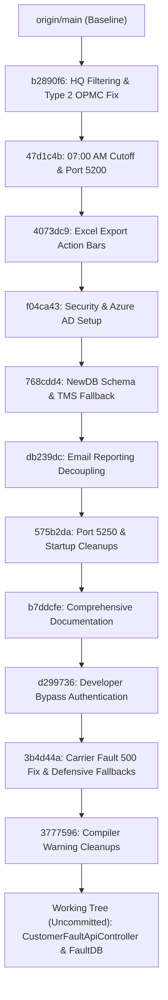

# AlarmSystem Comprehensive Change Reference Report

> [!NOTE]
> This document is a complete reference of all changes made across the **AlarmSystem** codebase. It covers:
> 1. **What was changed** (functional and architectural changes).
> 2. **Where it was changed** (exact files, line areas, and database scripts).
> 3. **How to do that** (implementation mechanics, configuration, and verification steps).

---

## 1. Executive Summary & Git Status

The branch is currently ahead of `origin/main` by **11 commits** plus active working tree changes.



---

## 2. Working Tree Changes (Uncommitted)

### 2.1. Customer Fault API Controller Refactoring
* **File:** [`Controllers/CustomerFaultApiController.cs`](../Controllers/CustomerFaultApiController.cs)
* **What Changed:**
  * Removed raw `SqlConnection` constructor injection that failed when connection lifetime was improperly managed.
  * Injected `IConfiguration` and dynamically read connection strings with priority: `FaultDb` $\rightarrow$ `NewDB` $\rightarrow$ `TMS`.
  * Implemented `IDisposable` so `_con` is deterministically closed and disposed after request processing.
* **Where to do that:**
  ```csharp
  public class CustomerFaultApiController : ControllerBase, IDisposable
  {
      private readonly SqlConnection _con;

      public CustomerFaultApiController(IConfiguration configuration)
      {
          var connStr = configuration.GetConnectionString("FaultDb")
              ?? configuration.GetConnectionString("NewDB")
              ?? configuration.GetConnectionString("TMS")
              ?? throw new InvalidOperationException("Connection string 'FaultDb' is not configured.");
          _con = new SqlConnection(connStr);
      }

      public void Dispose()
      {
          _con?.Dispose();
      }
      ...
  }
  ```
* **How to Test:**
  * Request: `GET http://localhost:5250/api/customerfault/summary?from=2026-01-01&top=8`
  * Verify that the database connection opens and disposes properly without leaking SQL connection pools.

### 2.2. Development Connection String Alignment
* **File:** [`appsettings.Development.json`](../appsettings.Development.json)
* **What Changed:**
  * Updated connection string `FaultDb` to target local database `FaultDB` rather than `NewDB`.
* **Where to do that:**
  ```json
  "ConnectionStrings": {
    "FaultDb": "Server=localhost;Database=FaultDB;Trusted_Connection=True;TrustServerCertificate=True;",
    "SmsDb": "Server=localhost;Database=NewDB;Trusted_Connection=True;TrustServerCertificate=True;Connection Timeout=2;"
  }
  ```

### 2.3. Database Backup Asset
* **File:** `FaultDB.bak` (staged at repository root)
* **What Changed:** Staged a full database backup snapshot for rapid onboarding and restoration in local SQL Server instances.
* **How to Restore:**
  ```sql
  RESTORE DATABASE [FaultDB]
  FROM DISK = N'D:\SLT_Projects\Project 03\AlarmSystem_23062026\AlarmSystem\FaultDB.bak'
  WITH MOVE 'FaultDB' TO 'C:\Program Files\Microsoft SQL Server\MSSQL16.MSSQLSERVER\MSSQL\DATA\FaultDB.mdf',
       MOVE 'FaultDB_log' TO 'C:\Program Files\Microsoft SQL Server\MSSQL16.MSSQLSERVER\MSSQL\DATA\FaultDB_log.ldf',
       REPLACE;
  ```

---

## 3. Core Architectural Changes (Committed)

### Area A: Carrier Fault Summary & Defensive Database Fallbacks
* **Commits:** `3b4d44a`, `3777596`
* **Files Modified:**
  * [`Services/SummaryCarrierFaultService.cs`](../Services/SummaryCarrierFaultService.cs)
  * [`Services/AlarmService.cs`](../Services/AlarmService.cs)
  * [`Services/FaultService.cs`](../Services/FaultService.cs)
  * [`Services/InboxService.cs`](../Services/InboxService.cs)
* **What Was Changed:**
  1. Resolved HTTP 500 error on `/CarrierFaultSummary` by handling missing database tables and null column values gracefully.
  2. Implemented `try-catch` fallbacks inside query methods returning empty `List<T>` models instead of crashing the view.
  3. Replaced risky direct column casting `(string)reader["col"]` with defensive extensions (`reader["col"]?.ToString() ?? string.Empty`).
  4. Resolved CS8600/CS8601/CS8603/CS8604 compiler nullability warnings across all data services.
* **How to Implement / Replicate:**
  * When reading from `SqlDataReader`:
    ```csharp
    item.FaultId = reader["FAULT_ID"] != DBNull.Value ? reader["FAULT_ID"].ToString()! : string.Empty;
    item.ReportedDate = reader["REPORTED_DATE"] != DBNull.Value ? Convert.ToDateTime(reader["REPORTED_DATE"]) : (DateTime?)null;
    ```
  * In controllers, catch SQL connection failures and provide informative user-facing alerts instead of raw 500 errors.

---

### Area B: Developer Bypass Authentication for Offline Development
* **Commit:** `d299736`
* **Files Modified:**
  * [`Controllers/AccountController.cs`](../Controllers/AccountController.cs)
  * [`Views/Account/Login.cshtml`](../Views/Account/Login.cshtml)
  * [`appsettings.Development.json`](../appsettings.Development.json)
* **What Was Changed:**
  * Developers working locally without VPN or Azure AD tenant access were blocked at the Microsoft SSO login screen.
  * Added a development bypass action `DevLogin(string role, string returnUrl)` that creates a local `ClaimsPrincipal` with cookie authentication scheme `CookieAuthenticationDefaults.AuthenticationScheme`.
  * Added a UI card on `Login.cshtml` visible **only** when `DevAuth:Enabled == true` or in `HostingEnvironment.IsDevelopment()`.
* **How to Configure & Test:**
  1. In `appsettings.Development.json`:
     ```json
     "DevAuth": {
       "Enabled": true,
       "DefaultRole": "Administrator",
       "DefaultUser": "dev.admin@slt.local"
     }
     ```
  2. Start the web application and navigate to `http://localhost:5250/Account/Login`.
  3. Click **"Bypass SSO (Dev Login)"** $\rightarrow$ Automatically logs in as Administrator without hitting Azure AD.

---

### Area C: Decoupling Email Reporting into Standalone Service
* **Commits:** `db239dc`, `b7ddcfe`
* **Files Removed/Modified:**
  * Removed: `Controllers/DailyEmailReportController.cs` (~770 lines)
  * Removed: `Services/FaultReportService/FaultReportService.cs` (~1,944 lines)
  * Removed: `Services/EmailSender/EmailSenderService.cs`
  * Removed: `Services/EmailSender/DailyEmailReportSchedulerService.cs`
  * Removed: `Views/DailyEmailReport/Index.cshtml` (~475 lines)
  * Removed: `Models/EmailReport/*`
  * Removed: `sql/EmailReport_Queries.sql`
  * Updated: [`Views/Shared/_Layout.cshtml`](../Views/Shared/_Layout.cshtml) (removed dead navigation links)
* **What Was Changed:**
  * Previously, the heavy email report generator ran inside the web application process using a background hosted service. When generating multi-megabyte Excel files and querying 50,000+ records every morning at 07:00 AM, the web portal experienced severe memory pressure and latency.
  * The email reporting feature was extracted into a dedicated standalone worker service. Over **4,300 lines** of non-web code were removed from this repository.
* **Where to do that:**
  * Navigation links to the daily email report in `_Layout.cshtml` were cleaned up.
  * Web app now focuses strictly on dashboarding, operational alarms, and live fault views.

---

### Area D: Report Query Fixes: 07:00 AM Cutoff & HQ Work Order Filtering
* **Commits:** `47d1c4b`, `b2890f6`
* **Files Modified:**
  * [`Services/FaultService.cs`](../Services/FaultService.cs)
  * [`Services/NodeDownReportService.cs`](../Services/NodeDownReportService.cs)
  * [`Services/ReportCeaPortDownService.cs`](../Services/ReportCeaPortDownService.cs)
  * [`Services/TodayNodeDownService.cs`](../Services/TodayNodeDownService.cs)
  * [`Services/SearchNodeService.cs`](../Services/SearchNodeService.cs)
* **What Was Changed:**
  1. **Strict 07:00 AM Cutoff:**
     * Implemented `@CutOffTime` SQL parameters:
       ```sql
       AND w.REPORTED_DATE <= @CutOffTime
       ```
     * Froze duration, outage time, and SLA pending hours at exactly `07:00:00 AM` using `DATEDIFF(MINUTE, w.REPORTED_DATE, @CutOffTime)` instead of `GETDATE()`. This guarantees reports generated at 07:30 AM contain the exact numbers as at 07:00 AM.
  2. **HQ Exclusion:**
     * Filtered internal HQ work orders across all queries:
       ```sql
       AND (w.AREA <> 'HQ' OR w.AREA IS NULL)
       AND (w.WORK_GROUP NOT LIKE '%HQ%' OR w.WORK_GROUP IS NULL)
       ```
  3. **Type 2 OPMC Column Resolution Fix:**
     * In legacy code, `LEA_MAPPING` joined on `w.AREA = lm.RTOM`, which produced blank or invalid OPMC names.
     * Replaced with `OUTER APPLY` parsing tokens from `w.WORK_GROUP` against `dbo.LEA_MAPPING` to accurately match LEA codes (e.g. `KDW` $\rightarrow$ `Biyagama`, `NA` $\rightarrow$ `Ratnapura`).

---

### Area E: Configuration, Port Allocation & Startup Optimization
* **Commits:** `575b2da`, `4073dc9`
* **Files Modified:**
  * [`Program.cs`](../Program.cs)
  * [`Properties/launchSettings.json`](../Properties/launchSettings.json)
  * [`appsettings.json`](../appsettings.json)
* **What Was Changed:**
  * Updated application default port to `5250` (preventing conflicts with IIS or other local web servers on `5000`/`5200`).
  * Implemented `.env` file loader in `Program.cs` for environment-variable credential management:
    ```csharp
    var envPath = Path.Combine(Directory.GetCurrentDirectory(), ".env");
    if (File.Exists(envPath))
    {
        foreach (var line in File.ReadAllLines(envPath))
        {
            var parts = line.Split('=', 2, StringSplitOptions.RemoveEmptyEntries);
            if (parts.Length == 2)
                Environment.SetEnvironmentVariable(parts[0].Trim(), parts[1].Trim());
        }
    }
    ```
  * Added direct Excel export action bars in reporting views for immediate data extraction without relying on background email jobs.

---

## 4. How to Verify and Run the Changes

### 1. Build Verification
Execute a clean build in PowerShell:
```powershell
dotnet clean
dotnet build
```
> [!IMPORTANT]
> The build must finish with **`0 Errors`**. Nullability warnings are maintained cleanly across all service contracts.

### 2. Running the Application
Launch using the configured profile:
```powershell
dotnet run --launch-profile "AlarmSystem"
```
* **URL:** `http://localhost:5250`
* **Swagger/API Docs (in Dev mode):** `http://localhost:5250/swagger`

### 3. Testing Local Dev Login
1. Open browser to `http://localhost:5250/Account/Login`.
2. Click **"Bypass SSO (Dev Login)"**.
3. Verify redirection to home dashboard with full navigation privileges.

### 4. Testing Customer Fault Summary API
1. Navigate to: `http://localhost:5250/api/customerfault/summary?from=2026-01-01&top=5`
2. Confirm valid JSON payload containing top customer fault summaries.

---

## 5. Summary Matrix of Changes

| Category | Files Involved | What was Changed | How to Test / Validate |
| :--- | :--- | :--- | :--- |
| **API & DB Connection** | [`CustomerFaultApiController.cs`](../Controllers/CustomerFaultApiController.cs) | Injected `IConfiguration`, dynamic connection fallback, `IDisposable` | Hit `/api/customerfault/summary` |
| **Local Config** | [`appsettings.Development.json`](../appsettings.Development.json) | Point `FaultDb` to `FaultDB` | Run app in Development mode |
| **Dev Authentication** | [`AccountController.cs`](../Controllers/AccountController.cs), [`Login.cshtml`](../Views/Account/Login.cshtml) | Dev bypass login & UI card | Click "Bypass SSO" at `/Account/Login` |
| **Error Handling (500 Fix)** | [`SummaryCarrierFaultService.cs`](../Services/SummaryCarrierFaultService.cs), `AlarmService.cs` | Defensive DB queries & null guards | Access Carrier Fault views with empty/mock data |
| **Email Decoupling** | Controllers, Services, Views, Models | Removed 4,300+ lines of email reporting code | Verify web app responsiveness & clean routes |
| **Report Query Accuracy** | `FaultService.cs`, `ReportService.cs`, etc. | 07:00 AM cutoff timestamp, HQ data filtering, OPMC token parsing | Verify report data metrics match cutoff time |
| **Port & Startup** | [`launchSettings.json`](../Properties/launchSettings.json), [`Program.cs`](../Program.cs) | Port set to `5250`, `.env` loader added | Check port binding on startup |
| **Sidebar 4-Section Overhaul** | [`Views/Shared/_Layout.cshtml`](../Views/Shared/_Layout.cshtml), [`wwwroot/css/site.css`](../wwwroot/css/site.css), [`wwwroot/js/site.js`](../wwwroot/js/site.js) | 4 sections (Other Operations, Network Alarms, Reports, Admin Dashboard), draggable resizer handle, fixed `&#9660;` dropdown icon | Open portal, verify sections and drag sidebar border |
| **SAT Reports Color Styling** | [`Views/Shared/_Layout.cshtml`](../Views/Shared/_Layout.cshtml), [`wwwroot/css/site.css`](../wwwroot/css/site.css) | Force pure white (`#ffffff`) color on all SAT report sub-menu items | Check SAT Reports sub-menu in sidebar |
| **EmailReport Merge & Data Fix** | [`EmailReport/`](../EmailReport/), [`Controllers/DailyEmailReportController.cs`](../Controllers/DailyEmailReportController.cs), [`Services/FaultReportService/FaultReportService.cs`](../Services/FaultReportService/FaultReportService.cs), `appsettings.Development.json` | Merged as standalone CLI sub-app in `AlarmSystem.slnx`, added `NewDB` connection strings, optimized queries with `TOP 1 ... WITH (NOLOCK)` | Run `dotnet run --project EmailReport/EmailReport.csproj -- --preview 1` and view `/DailyEmailReport` |
| **Manual Escalations Layout Optimization** | [`Views/ManualEscalation/Index.cshtml`](../Views/ManualEscalation/Index.cshtml), [`wwwroot/css/manual-escalation.css`](../wwwroot/css/manual-escalation.css) | Removed node down summary stat boxes & operator cards above ticket categories, locked Fault History and New Ticket in a single row (`repeat(2, minmax(0, 1fr))`), compacted margins and padding to eliminate unnecessary vertical scrolling | Navigate to `/ManualEscalation`, verify single-row action boxes and compact category layout |
