# 09. UI Sidebar Navigation Tree Architecture

## 1. Overview & Objective

This document defines the restructured 4-section taxonomy for the **AlarmSystem** UI sidebar navigation menu in [`Views/Shared/_Layout.cshtml`](../Views/Shared/_Layout.cshtml). 

The existing flat navigation is reorganized into four distinct operational domains:
1. **Other Operators** (Operator & Customer Operations sub-views)
2. **Network Alarms** (Live alarm monitoring, escalation management, and search tools)
3. **Reports** (Operational failure reports, historical analytics, and automated SAT email reports)
4. **Admin Dashboard** (System configuration, parameters, and administration)

---

## 2. Visual Architecture Diagram

```mermaid
graph TD
    Root["AlarmSystem Sidebar"] --> S1["1. Other Operators"]
    Root --> S2["2. Network Alarms"]
    Root --> S3["3. Reports"]
    Root --> S4["4. Admin Dashboard"]

    %% Section 1
    S1 --> S1_1["Dashboard"]
    S1 --> S1_2["Realtime Alarm"]
    S1 --> S1_3["Customer Fault (OSS)"]
    S1 --> S1_4["Customer Details"]
    S1 --> S1_5["Network Element Details"]

    %% Section 2
    S2 --> S2_01["Manual Escalations"]
    S2 --> S2_02["Alarms"]
    S2 --> S2_03["Fault-Dockets"]
    S2 --> S2_04["Inbox"]
    S2 --> S2_05["Views"]
    S2 --> S2_06["Starlink"]
    S2 --> S2_07["Links"]
    S2 --> S2_08["Alarm Delays"]
    S2 --> S2_09["Trouble Ticket"]
    S2 --> S2_10["Power Alarm"]
    S2 --> S2_11["RPB Summary"]
    S2 --> S2_12["Search"]
    S2_12 --> S2_12_1["Search Circuit"]
    S2_12 --> S2_12_2["Search By Node Name"]

    %% Section 3
    S3 --> S3_01["SAT Reports"]
    S3_01 --> S3_01_1["Type 1: Regional Network Teams Pending Faults"]
    S3_01 --> S3_01_2["Type 2: OPMC Pending Faults"]
    S3_01 --> S3_01_3["Type 3: SLT NOC Midnight Status"]
    S3_01 --> S3_01_4["Type 4: Full Network Failure Summary"]
    S3 --> S3_02["Today Node Down"]
    S3 --> S3_03["Summary Carrier Faults"]
    S3 --> S3_04["Summary Network Faults"]
    S3 --> S3_05["Node Down"]
    S3 --> S3_06["AC Mains Failure"]
    S3 --> S3_07["Alarm History Network Engineer"]
    S3 --> S3_08["Alarm History Provincewise"]
    S3 --> S3_09["Summary"]
    S3 --> S3_10["CEA Port Report"]

    %% Section 4
    S4 --> S4_1["Config"]
```



---

## 3. Sidebar Navigation ASCII Tree

```text
AlarmSystem Navigation
├── [📁] 1. OTHER OPERATORS
│   ├── [📄] Dashboard                   (/Home/Dashboard)
│   ├── [📄] Realtime Alarm              (/Home/RealtimeAlarm)
│   ├── [📄] Customer Fault (OSS)        (/Home/CustomerFaultOss)
│   ├── [📄] Customer Details            (/Home/CustomerDetails)
│   └── [📄] Network Element Details     (/Home/NetworkElementDetails)
│
├── [📁] 2. NETWORK ALARMS
│   ├── [📄] Manual Escalations          (/ManualEscalation/Index)
│   ├── [📄] Alarms                      (/Alarm/Index)
│   ├── [📄] Fault-Dockets               (/FaultDockets/Index)
│   ├── [📄] Inbox                       (/Inbox/Index)
│   ├── [📄] Views                       (/Views/Index)
│   ├── [📄] Starlink                    (/Home/ApiTester)
│   ├── [📄] Links                       (/Links/Index)
│   ├── [📄] Alarm Delays                (/AlarmDelay/Index)
│   ├── [📄] Trouble Ticket              (/TroubleTicket/Index)
│   ├── [📄] Power Alarm                 (/PowerAlarm/Index)
│   ├── [📄] RPB Summary                 (/RPBSummary/Index)
│   └── [📁] Search                      (Collapsible Sub-group)
│       ├── [📄] Search Circuit          (/CircuitId/Index)
│       └── [📄] Search By Node Name     (/SearchByNode/Index)
│
├── [📁] 3. REPORTS
│   ├── [📁] SAT Reports                 (Collapsible Sub-group - Automated Daily Email Reports)
│   │   ├── [📄] Email Reports Dashboard (/DailyEmailReport)
│   │   ├── [📄] Type 1: Regional Network Teams Pending Faults
│   │   ├── [📄] Type 2: OPMC Pending Work Orders
│   │   ├── [📄] Type 3: SLT NOC Midnight Status
│   │   └── [📄] Type 4: Network Failure Summary
│   ├── [📄] Today Node Down             (/TodayNodeDown/Index)
│   ├── [📄] Summary Carrier Faults      (/SummaryCarrierFaults/Index)
│   ├── [📄] Summary Network Faults      (/SummaryNetworkFaults/Index)
│   ├── [📄] Node Down                   (/NodeDownReport/Index)
│   ├── [📄] AC Mains Failure            (/ACMainFailure/Index)
│   ├── [📄] Alarm History Network Eng.  (/AlarmHistoryEngineer/Index)
│   ├── [📄] Alarm History Provincewise  (/AlarmHistoryProvince/Index)
│   ├── [📄] Summary                     (/Summary/Index)
│   └── [📄] CEA Port Report             (/Report/NodeDownReport)
│
└── [📁] 4. ADMIN DASHBOARD
    └── [📄] Config                      (/Config/Index)
```

---

## 4. Comprehensive Route & Action Mapping Catalog

### Section 1: Other Operators

| Navigation Item | Type | Controller | Action | Target URL Route | FontAwesome Icon | Description |
| :--- | :--- | :--- | :--- | :--- | :--- | :--- |
| **Other Operators** | Section Header | - | - | - | `fa-users-gear` | Group container for operator interfaces |
| **Dashboard** | Sub-item | `Home` | `Dashboard` | `/Home/Dashboard` | `fa-gauge-high` | Operations summary and metrics dashboard |
| **Realtime Alarm** | Sub-item | `Home` | `RealtimeAlarm` | `/Home/RealtimeAlarm` | `fa-bell` | Live incoming telemetry and alarms |
| **Customer Fault (OSS)** | Sub-item | `Home` | `CustomerFaultOss` | `/Home/CustomerFaultOss` | `fa-headset` | Clarity OSS customer trouble ticket stream |
| **Customer Details** | Sub-item | `Home` | `CustomerDetails` | `/Home/CustomerDetails` | `fa-address-card` | Customer account and circuit lookup |
| **Network Element Details** | Sub-item | `Home` | `NetworkElementDetails` | `/Home/NetworkElementDetails` | `fa-server` | Equipment specifications and node inventory |

---

### Section 2: Network Alarms

| Navigation Item | Type | Controller | Action | Target URL Route | FontAwesome Icon | Description |
| :--- | :--- | :--- | :--- | :--- | :--- | :--- |
| **Network Alarms** | Section Header | - | - | - | `fa-triangle-exclamation` | Group container for alarm management |
| **Manual Escalations** | Direct Link | `ManualEscalation` | `Index` | `/ManualEscalation` | `fa-arrow-up-right-from-square` | Engineer & supervisor ticket escalation |
| **Alarms** | Direct Link | `Alarm` | `Index` | `/Alarm` | `fa-tower-broadcast` | Primary active alarm grid & filters |
| **Fault-Dockets** | Direct Link | `FaultDockets` | `Index` | `/FaultDockets` | `fa-folder-open` | Open trouble tickets and dockets |
| **Inbox** | Direct Link | `Inbox` | `Index` | `/Inbox` | `fa-inbox` | Operator assigned notifications and alerts |
| **Views** | Direct Link | `Views` | `Index` | `/Views` | `fa-table-columns` | Customized grid and operational views |
| **Starlink** | Direct Link | `Home` | `ApiTester` | `/Home/ApiTester` | `fa-satellite` | Starlink terminal diagnostics and API status |
| **Links** | Direct Link | `Links` | `Index` | `/Links` | `fa-link` | NOC portal shortcuts & external system links |
| **Alarm Delays** | Direct Link | `AlarmDelay` | `Index` | `/AlarmDelay` | `fa-clock-rotate-left` | Delayed alarm threshold monitoring |
| **Trouble Ticket** | Direct Link | `TroubleTicket` | `Index` | `/TroubleTicket` | `fa-ticket` | Clarity trouble ticket resolution tracker |
| **Power Alarm** | Direct Link | `PowerAlarm` | `Index` | `/PowerAlarm` | `fa-bolt` | Generator, battery, and mains outages |
| **RPB Summary** | Direct Link | `RPBSummary` | `Index` | `/RPBSummary` | `fa-chart-pie` | Regional Performance Board alarm breakdown |
| **Search** | Sub-Group | - | - | - | `fa-magnifying-glass` | Search dropdown group |
| ↳ *Search Circuit* | Sub-item | `CircuitId` | `Index` | `/CircuitId` | `fa-route` | Circuit ID lookup |
| ↳ *Search By Node Name* | Sub-item | `SearchByNode` | `Index` | `/SearchByNode` | `fa-network-wired` | Node / MSAN search |

---

### Section 3: Reports

| Navigation Item | Type | Controller | Action | Target URL Route | FontAwesome Icon | Description |
| :--- | :--- | :--- | :--- | :--- | :--- | :--- |
| **Reports** | Section Header | - | - | - | `fa-chart-line` | Operational reporting subsystem |
| **SAT Reports** | Sub-Group | - | - | - | `fa-envelope-open-text` | Executive daily automated email report previews |
| ↳ *Type 1 (08:00 AM)* | Sub-item | `DailyEmailReport` / `Preview` | `Type1` | `/preview-email?type=1` | `fa-file-excel` | Regional Network Teams Pending Faults |
| ↳ *Type 2 (07:00 AM)* | Sub-item | `DailyEmailReport` / `Preview` | `Type2` | `/preview-email?type=2` | `fa-file-excel` | OPMC Pending Work Orders & Faults |
| ↳ *Type 3 (00:15 AM)* | Sub-item | `DailyEmailReport` / `Preview` | `Type3` | `/preview-email?type=3` | `fa-file-excel` | SLT NOC Midnight Operations Summary |
| ↳ *Type 4 (08:00 AM)* | Sub-item | `DailyEmailReport` / `Preview` | `Type4` | `/preview-email?type=4` | `fa-file-excel` | Full Network Failure Summary Report |
| **Today Node Down** | Direct Link | `TodayNodeDown` | `Index` | `/TodayNodeDown` | `fa-calendar-day` | Node outages recorded today |
| **Summary Carrier Faults**| Direct Link | `SummaryCarrierFaults` | `Index` | `/SummaryCarrierFaults` | `fa-briefcase` | Wholesale leased line & carrier issues |
| **Summary Network Faults**| Direct Link | `SummaryNetworkFaults` | `Index` | `/SummaryNetworkFaults` | `fa-diagram-project` | Core network fault aggregations |
| **Node Down** | Direct Link | `NodeDownReport` | `Index` | `/NodeDownReport` | `fa-circle-down` | Comprehensive active node failure catalog |
| **AC Mains Failure** | Direct Link | `ACMainFailure` | `Index` | `/ACMainFailure` | `fa-plug-circle-xmark` | Commercial power outage telemetry |
| **Alarm History Network Eng.** | Direct Link | `AlarmHistoryEngineer` | `Index` | `/AlarmHistoryEngineer` | `fa-user-gear` | Historical tickets grouped by assigned engineer |
| **Alarm History Provincewise** | Direct Link | `AlarmHistoryProvince` | `Index` | `/AlarmHistoryProvince` | `fa-map-location-dot` | Regional breakdown across Sri Lanka provinces |
| **Summary** | Direct Link | `Summary` | `Index` | `/Summary` | `fa-chart-column` | General NOC operational summary |
| **CEA Port Report** | Direct Link | `Report` | `NodeDownReport` | `/Report/NodeDownReport` | `fa-ethernet` | Customer Edge Access port failure status |

---

### Section 4: Admin Dashboard

| Navigation Item | Type | Controller | Action | Target URL Route | FontAwesome Icon | Description |
| :--- | :--- | :--- | :--- | :--- | :--- | :--- |
| **Admin Dashboard** | Section Header | - | - | - | `fa-shield-halved` | Administrative & system configuration group |
| **Config** | Sub-item / Link | `Config` | `Index` | `/Config` | `fa-gears` | Application parameters, thresholds & settings |

---

## 5. Razor HTML Layout Implementation Blueprint

To apply this navigation in [`Views/Shared/_Layout.cshtml`](../Views/Shared/_Layout.cshtml), replace the existing side-menu navigation `<nav class="side-menu-nav">` with the following modular section template:

```html
<nav class="side-menu-nav">

    <!-- ========================================== -->
    <!-- 1. OTHER OPERATORS                         -->
    <!-- ========================================== -->
    <div class="side-section-header">
        <i class="fa-solid fa-users-gear me-2"></i>Other Operators
    </div>
    <div class="side-link-group">
        <div class="side-link-row">
            <a class="side-link side-link-parent" href="#">Operations</a>
            <button class="side-link-expander expanded" type="button" data-menu-toggle="other-ops-submenu">
                <span>▾</span>
            </button>
        </div>
        <div id="other-ops-submenu" class="side-submenu open">
            <a class="side-sublink" asp-controller="Home" asp-action="Dashboard"><i class="fa-solid fa-gauge-high me-2"></i>Dashboard</a>
            <a class="side-sublink" asp-controller="Home" asp-action="RealtimeAlarm"><i class="fa-solid fa-bell me-2"></i>Realtime Alarm</a>
            <a class="side-sublink" asp-controller="Home" asp-action="CustomerFaultOss"><i class="fa-solid fa-headset me-2"></i>Customer Fault (OSS)</a>
            <a class="side-sublink" asp-controller="Home" asp-action="CustomerDetails"><i class="fa-solid fa-address-card me-2"></i>Customer Details</a>
            <a class="side-sublink" asp-controller="Home" asp-action="NetworkElementDetails"><i class="fa-solid fa-server me-2"></i>Network Element Details</a>
        </div>
    </div>

    <!-- ========================================== -->
    <!-- 2. NETWORK ALARMS                          -->
    <!-- ========================================== -->
    <div class="side-section-header">
        <i class="fa-solid fa-triangle-exclamation me-2"></i>Network Alarms
    </div>
    <a class="side-link" asp-controller="ManualEscalation" asp-action="Index"><i class="fa-solid fa-arrow-up-right-from-square me-2"></i>Manual Escalations</a>
    <a class="side-link" asp-controller="Alarm" asp-action="Index"><i class="fa-solid fa-tower-broadcast me-2"></i>Alarms</a>
    <a class="side-link" asp-controller="FaultDockets" asp-action="Index"><i class="fa-solid fa-folder-open me-2"></i>Fault-Dockets</a>
    <a class="side-link" asp-controller="Inbox" asp-action="Index"><i class="fa-solid fa-inbox me-2"></i>Inbox</a>
    <a class="side-link" asp-controller="Views" asp-action="Index"><i class="fa-solid fa-table-columns me-2"></i>Views</a>
    <a class="side-link" asp-controller="Home" asp-action="ApiTester"><i class="fa-solid fa-satellite me-2"></i>Starlink</a>
    <a class="side-link" asp-controller="Links" asp-action="Index"><i class="fa-solid fa-link me-2"></i>Links</a>
    <a class="side-link" asp-controller="AlarmDelay" asp-action="Index"><i class="fa-solid fa-clock-rotate-left me-2"></i>Alarm Delays</a>
    <a class="side-link" asp-controller="TroubleTicket" asp-action="Index"><i class="fa-solid fa-ticket me-2"></i>Trouble Ticket</a>
    <a class="side-link" asp-controller="PowerAlarm" asp-action="Index"><i class="fa-solid fa-bolt me-2"></i>Power Alarm</a>
    <a class="side-link" asp-controller="RPBSummary" asp-action="Index"><i class="fa-solid fa-chart-pie me-2"></i>RPB Summary</a>

    <!-- Sub-menu: Search -->
    <div class="side-link-group">
        <div class="side-link-row">
            <a class="side-link side-link-parent" href="#"><i class="fa-solid fa-magnifying-glass me-2"></i>Search</a>
            <button class="side-link-expander" type="button" data-menu-toggle="search-submenu">
                <span>▾</span>
            </button>
        </div>
        <div id="search-submenu" class="side-submenu">
            <a class="side-sublink" asp-controller="CircuitId" asp-action="Index"><i class="fa-solid fa-route me-2"></i>Search Circuit</a>
            <a class="side-sublink" asp-controller="SearchByNode" asp-action="Index"><i class="fa-solid fa-network-wired me-2"></i>Search By Node Name</a>
        </div>
    </div>

    <!-- ========================================== -->
    <!-- 3. REPORTS                                 -->
    <!-- ========================================== -->
    <div class="side-section-header">
        <i class="fa-solid fa-chart-line me-2"></i>Reports
    </div>

    <!-- Sub-menu: SAT Reports -->
    <div class="side-link-group">
        <div class="side-link-row">
            <a class="side-link side-link-parent" href="#"><i class="fa-solid fa-envelope-open-text me-2"></i>SAT Reports</a>
            <button class="side-link-expander" type="button" data-menu-toggle="sat-reports-submenu">
                <span>▾</span>
            </button>
        </div>
        <div id="sat-reports-submenu" class="side-submenu">
            <a class="side-sublink" href="/preview-email?type=1">Type 1: Regional Network Teams</a>
            <a class="side-sublink" href="/preview-email?type=2">Type 2: OPMC Pending Work Orders</a>
            <a class="side-sublink" href="/preview-email?type=3">Type 3: SLT NOC Midnight Status</a>
            <a class="side-sublink" href="/preview-email?type=4">Type 4: Network Failure Summary</a>
        </div>
    </div>

    <a class="side-link" asp-controller="TodayNodeDown" asp-action="Index"><i class="fa-solid fa-calendar-day me-2"></i>Today Node Down</a>
    <a class="side-link" asp-controller="SummaryCarrierFaults" asp-action="Index"><i class="fa-solid fa-briefcase me-2"></i>Summary Carrier Faults</a>
    <a class="side-link" asp-controller="SummaryNetworkFaults" asp-action="Index"><i class="fa-solid fa-diagram-project me-2"></i>Summary Network Faults</a>
    <a class="side-link" asp-controller="NodeDownReport" asp-action="Index"><i class="fa-solid fa-circle-down me-2"></i>Node Down</a>
    <a class="side-link" asp-controller="ACMainFailure" asp-action="Index"><i class="fa-solid fa-plug-circle-xmark me-2"></i>AC Mains Failure</a>
    <a class="side-link" asp-controller="AlarmHistoryEngineer" asp-action="Index"><i class="fa-solid fa-user-gear me-2"></i>Alarm History Network Eng.</a>
    <a class="side-link" asp-controller="AlarmHistoryProvince" asp-action="Index"><i class="fa-solid fa-map-location-dot me-2"></i>Alarm History Provincewise</a>
    <a class="side-link" asp-controller="Summary" asp-action="Index"><i class="fa-solid fa-chart-column me-2"></i>Summary</a>
    <a class="side-link" asp-controller="Report" asp-action="NodeDownReport"><i class="fa-solid fa-ethernet me-2"></i>CEA Port Report</a>

    <!-- ========================================== -->
    <!-- 4. ADMIN DASHBOARD                         -->
    <!-- ========================================== -->
    <div class="side-section-header">
        <i class="fa-solid fa-shield-halved me-2"></i>Admin Dashboard
    </div>
    <a class="side-link" asp-controller="Config" asp-action="Index"><i class="fa-solid fa-gears me-2"></i>Config</a>

</nav>
```

